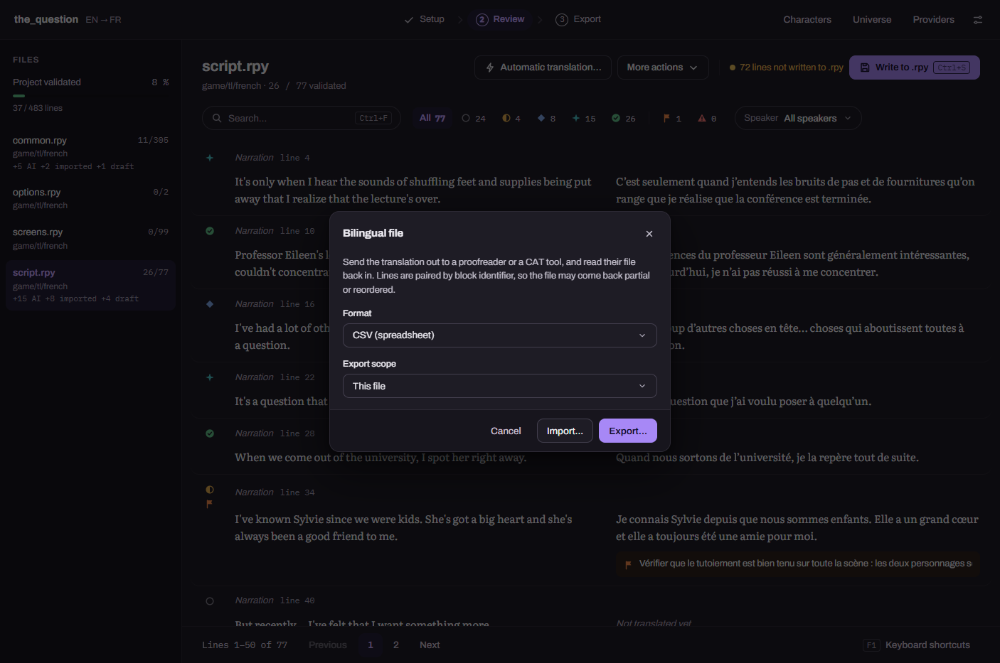

[← Documentation](README.md)

# Bilingual files

*[Version française](../fr/bilingual-files.md)*

Two ways to move translations in and out without touching the game files:
a file you send to someone, and a memory shared between your own projects.

## Import and export

Reached from **Import / export…** in the **More actions** menu of the
review toolbar, or from **Import / export…** in a single file's
right-click menu.

| Format | For |
|---|---|
| **CSV (spreadsheet)** | A spreadsheet. The format a proofreader without special tools will accept. |
| **XLIFF 1.2 (OmegaT, memoQ)** | A CAT tool — OmegaT, memoQ, Trados. |
| **JSON** | A script of your own. |

**Export scope** is either **This file** (the file you are looking at) or
**All files**. **Export…** asks where to save the file; the whole scope
goes out, untranslated lines included, since sending it to a translator is
the point. Source files are written relative to the game folder.

**Import…** accepts `.csv`, `.xlf`, `.xliff` and `.json` files, in UTF-8.
Before anything is written, a confirmation dialog says how many
translations will be written and counts what will be left out.

### Coming back

Lines are paired by **block identifier**, never by position. That has one
consequence worth relying on: the file may come back **partial or
reordered** and it will still import correctly. A proofreader may delete
the rows they had nothing to say about, sort the sheet by speaker, or
send back only the first chapter.

Each line also carries the source text it was exported with. If the game
text changed since the export, the line is skipped rather than paired with
a text it was not written for.

Every translation that comes back changed is written as **imported**,
whatever status the file gives it: the *status* column in CSV and JSON
or the XLIFF `state` is not taken into account. A file comes from
outside and nobody has read it *here*, so it can neither validate a line
nor turn a proofreader's text into an *AI suggestion*.

- A line you already validated is never replaced by an import. Edit it
  in the review screen if the proofreader is right.
- A translation identical to the one the project holds changes nothing,
  so a file exported and imported back untouched leaves the project as it
  was.

> An imported file is untrusted input. A line that adds a Ren'Py
> `[interpolation]` the source did not have is refused outright: Ren'Py
> would run it as code. The other quality checks (a lost `{tag}` or
> `[variable]`) run when you validate the line, as for any other. See
> [Troubleshooting](troubleshooting.md).

The confirmation dialog and the summary that follows name each case:

| The summary says | Meaning |
|---|---|
| *unknown in this project* | The block identifier is not in this project (typically a file from another game). Ignored. |
| *whose source text has changed since the export* | Skipped. |
| *without a translation* | The row came back empty. Ignored: what the project holds is not cleared. |
| *already validated, left untouched* | A validated line the file would have changed. Not written. |
| *refused, adding an interpolation absent from the source* | Not written. |

### Spreadsheet precautions

The game's text is untrusted, and a line such as `=HYPERLINK(...)` or
`-- Hello` is a formula to a spreadsheet. In a CSV export, any cell that
starts with `=`, `+`, `-` or `@` (or a tab or a carriage return) gets a
leading apostrophe, which the import removes again. The file is UTF-8 with
a byte order mark, so accented translations open correctly in Excel.

XLIFF is read without ever expanding entities: a document that declares
one is refused.

## Translation memory

**Memory**, in the **More actions** menu of the review toolbar, fills
untranslated lines from a store shared by every project on this machine.

- It is fed by **human validations only**. Nothing a provider suggested
  goes in until you have said yes to it.
- It answers for a **language pair**, on the source text as written, then
  on near-identical text: letter case, repeated spaces and trailing
  punctuation are ignored. `[variables]` and `{tags}` must match exactly.
- It fills **the whole project**, never a single file: the memory answers
  for a language pair, and a per-file scope would just make you walk every
  file to reach the same result.
- It only ever touches *Not translated* lines, so it needs no
  confirmation, and what it writes lands as **imported**.

It pays off from the second game in a series onward, and on the interface
strings of `screens.rpy` and `common.rpy`, which are nearly identical
across games.

The settings dialog lists, for each language pair, how many entries the
memory holds, and lets you forget a pair. Projects keep their own
translations when you do.
