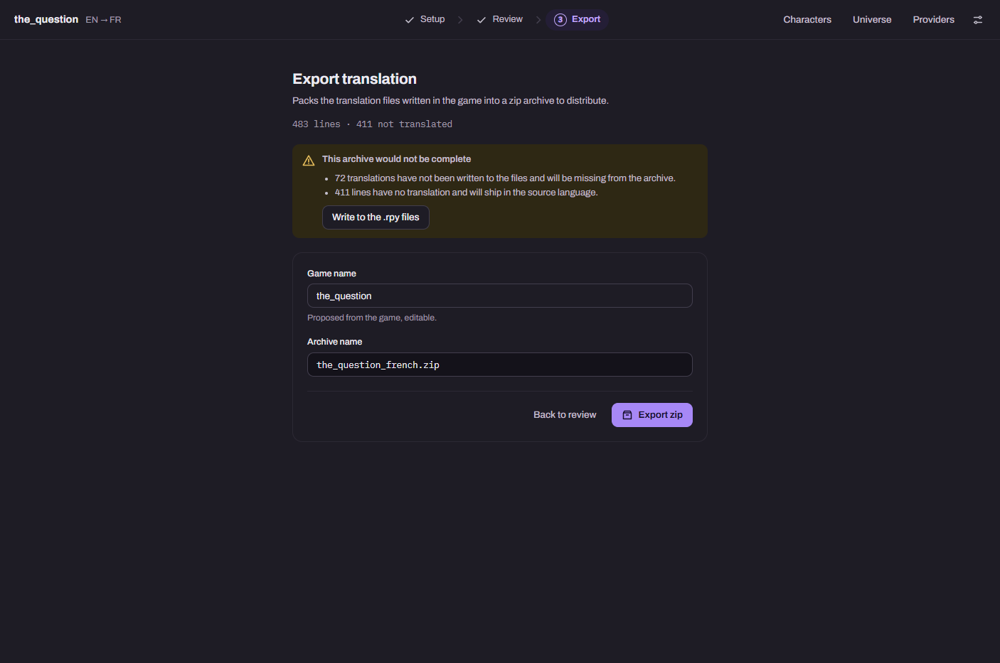

[← Documentation](README.md)

# Export

*[Version française](../fr/export.md)*

Two distinct steps: writing the `.rpy` files, then packing them into a zip.

## Writing the .rpy files

**Save to .rpy** in the review toolbar (`Ctrl`+`S`). Beside it, a counter
says how many lines exist only in the database so far (*N lines not written
to .rpy*), or that the *.rpy files are up to date*.

The writer rewrites `game/tl/<language>/`, matching dialogue blocks by
their Ren'Py **block identifier** and `strings` blocks by their `old`
text — never by position. Before a file is modified, its previous version
is copied under `<game>/.rts/backups/`.

This is the step that makes the translation real: everything before it
lives in `<game>/.rts/translations.db`, which Ren'Py knows nothing about.
Every line that has text is written, whatever its
[status](translation-statuses.md). If nothing is translated yet, there is
nothing to save and the application says so.

## The zip

Reached from the **Export** step of the progress bar, at the top of the
screen.



The screen shows how many lines the project holds and how many are not
translated. Two fields prepare the archive:

- **Game name** — proposed from the game (the `build.name` set in its
  `options.rpy`, falling back to the folder name), and editable.
- **Archive name** — read-only, derived from the game name and the target
  language, as `<game name>_<language>.zip`.

**Export zip** asks where to save the archive. It has the layout a player
expects to drop into a game:

```
<game name>/game/tl/<language>/
```

`.rpyc` files are excluded — those are Ren'Py's compiled output and the
engine regenerates them. Any entry whose path contains `../` is refused
rather than written, and so is a game name that is blank, `.`, `..` or
contains a slash, a backslash or a colon (a blank name becomes `game`). The
archive is written under a temporary name and moved into place at the end,
so a failed export leaves no partial zip.

Once the zip is written, the sources unpacked from the game's `.rpa`
archives for the extraction are removed from `game/`.

### When the archive would not be complete

If something is off, a dialog titled *This archive would not be complete*
lists it before anything is written:

- no translation was ever written to the `.rpy` files, so the archive
  would only contain the source language;
- some translations have not been written to the files yet and would be
  missing;
- the `tl/` files were modified outside the application since the last
  save, and those changes will be overwritten by the next save;
- some lines have no translation and will ship in the source language;
- some lines carry a quality problem (a lost tag or an added
  interpolation), with the files that hold the most of them named.

**Export anyway** goes on regardless. The same list appears on the export
screen with a **Write to the .rpy files** button when saving would settle
it: use it first.

While a translation job is running, the other steps of the progress bar are
unavailable: cancel the job or let it finish before exporting.

## Sending it out

The generated `tl/` folder ships to the game's players, which is why
[quality checks](troubleshooting.md) on interpolations are refusals rather
than warnings: Ren'Py evaluates whatever sits between square brackets as a
Python expression.
