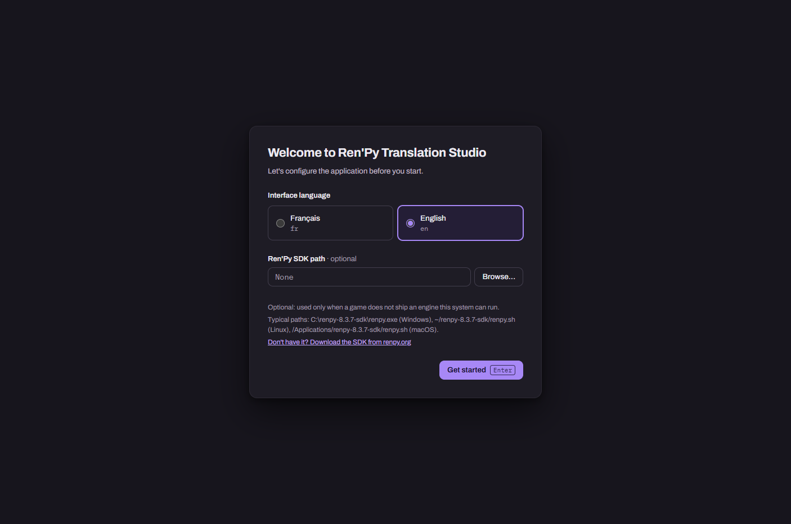
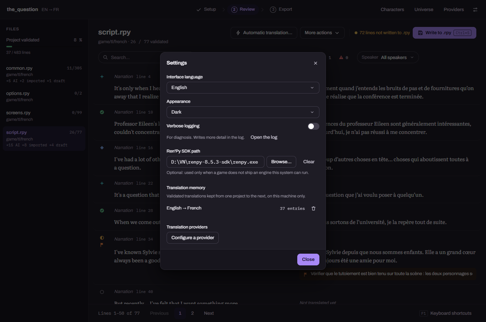

[← Documentation](README.md)

# Installation

*[Version française](../fr/installation.md)*

## What you need

- **The installer for your system**, or the source code if you prefer to
  build the application yourself (see the end of this page). Nothing else
  has to be installed first: no Python, no runtime.
- **A Ren'Py engine to extract with.** Usually you already have one: see
  below.
- **A provider account or endpoint**, only if you want machine or LLM
  translation. The application is perfectly usable as a plain review tool
  without any.

### About the Ren'Py engine

Extraction runs Ren'Py's own `translate` command, so something has to
provide that command. Two sources, in this order:

1. **The engine the game ships with.** A packaged Ren'Py game carries its
   own engine, in the exact version its sources were written for. That is
   the right one by construction, and it is used whenever this system can
   run it.
2. **A Ren'Py SDK you installed**, as a fallback. Needed when the game's
   own engine cannot run here — a `-win` build opened from Linux, for
   instance, since it only contains Windows runtimes.

The SDK is therefore **optional**. Set it later, from the settings dialog,
if a game ever asks for it.

> Version matters. Ren'Py 8 rejects screen syntax that Ren'Py 7 accepted,
> and every source file it refuses takes its lines out of the extraction.
> Measured on one real game: the SDK 8.5.3 rejected 3 sources and produced
> 40 739 units, while the game's own 7.5.3 engine rejected none and
> produced 40 820.

> Running the game's engine means running third-party code — the same
> executable you would launch to play. Only extract games you would be
> willing to run.

## Get the application

The installers are built by the repository's **Rust** workflow, one runner
per system, and published as artifacts of its run (Actions tab of the
repository). One artifact per system:

| System  | Artifact  | What it contains                           |
|---------|-----------|--------------------------------------------|
| Windows | `windows` | an NSIS installer (`.exe`)                 |
| Linux   | `linux`   | a Debian package (`.deb`) and an AppImage |

The installed application is called **Renpy Translation Studio** (the
window title keeps the apostrophe: Ren'Py Translation Studio). It carries
`rts-mcp`, the MCP server, next to its own executable: see
[MCP server](mcp-server.md).

On Linux, the AppImage must be made executable again after the download
(`chmod +x`), since downloading an artifact drops the permission bits.

These installers are unsigned, so the operating system may warn you the
first time you run them.

## First launch



Two things are asked, and both can be changed later:

- **Interface language** — English or French.
- **Ren'Py SDK path** — optional, as explained above. Leave it empty
  until a game needs it. The field tells you whether the path holds a
  Ren'Py executable (*SDK found* or *No Ren'Py executable found at this
  path*).

Click **Get started** to continue.

Everything else is set from the gear icon (**Settings**) in the header.



The dialog holds:

- **Interface language**.
- **Appearance** — *Dark*, *Light* or *Same as the system*, applied
  immediately.
- **Verbose logging** — writes more detail in the log, for diagnosis.
  **Open the log** shows the log file in your file manager.
- **Ren'Py SDK path**.
- **Translation memory** — the validated translations kept from one
  project to the next on this machine, per language pair, which you can
  forget one pair at a time.

API keys are not stored in the settings file: they go to the operating
system's keyring (Windows Credential Manager, macOS Keychain, Secret
Service on Linux). Without a keyring, the application cannot save a key.

## Where things live

| What                                               | Where                                          |
|----------------------------------------------------|------------------------------------------------|
| Settings, recent projects, translation memory, log | the application's configuration folder (below) |
| A project's translations                           | `<game>/.rts/translations.db`                  |

The configuration folder is:

- **Windows**: `%LOCALAPPDATA%\renpy-translation-studio\`
- **macOS**: `~/Library/Application Support/renpy-translation-studio/`
- **Linux**: `~/.config/renpy-translation-studio/`

In it: `settings.json`, `projects.json` (the recent projects, also what the
MCP server may open) and `renpy-translation-studio.log`. The log only
receives the application's own diagnostics, never an API key, and is moved
to `renpy-translation-studio.log.1` once it passes 5 MB.

### Coming from 1.x

The settings, projects and translation memory of version 1.x are read as
they are: open the application and your recent projects are there. Claude
and Mistral, which 1.0.0 had already removed, are not coming back; DeepL,
Ollama and LibreTranslate are the three providers.

## Building from source

You need [Node.js](https://nodejs.org/) 22, a stable
[Rust](https://rustup.rs/) toolchain, and on Linux the libraries Tauri
needs (`libwebkit2gtk-4.1-dev`, `libayatana-appindicator3-dev`,
`librsvg2-dev`, `libxdo-dev`, `libssl-dev`, `libdbus-1-dev`,
`pkg-config`, `patchelf`).

```bash
git clone https://github.com/lambda-vn/renpy-translation-studio.git
cd renpy-translation-studio/rust
npm install
```

Run the application in development mode:

```bash
npm run tauri dev
```

Build the installer for the system you are on (long: it compiles in
release mode and also builds `rts-mcp`):

```bash
npm run bundle
```

Tauri does not cross-compile: each system builds its own installer, which
is why the workflow uses one runner per system.
