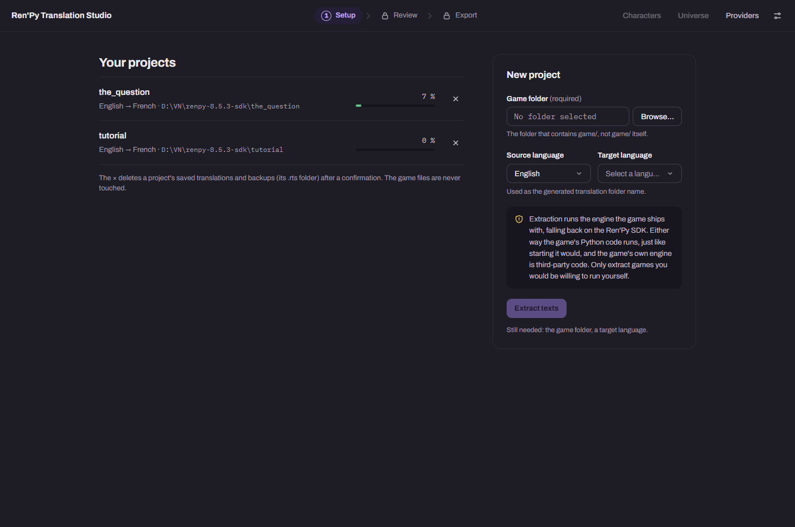
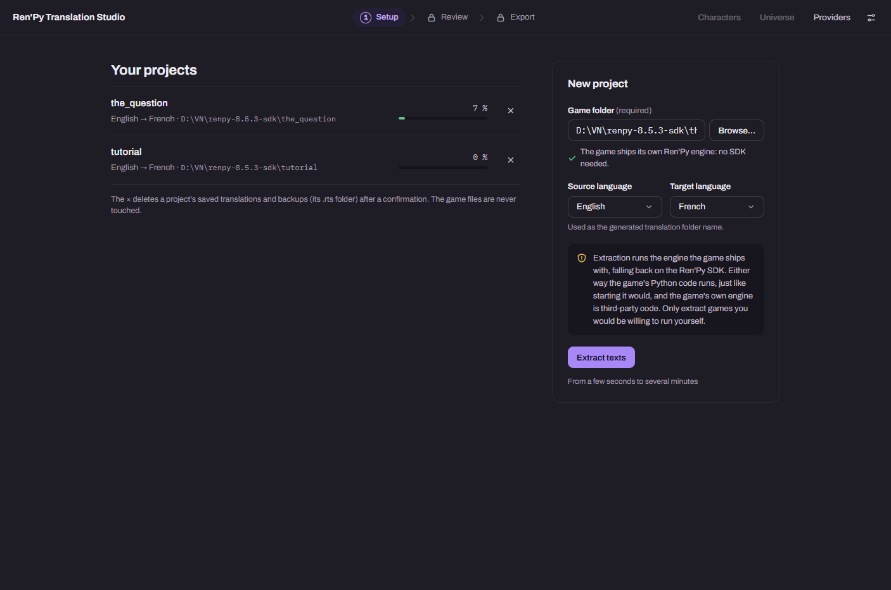
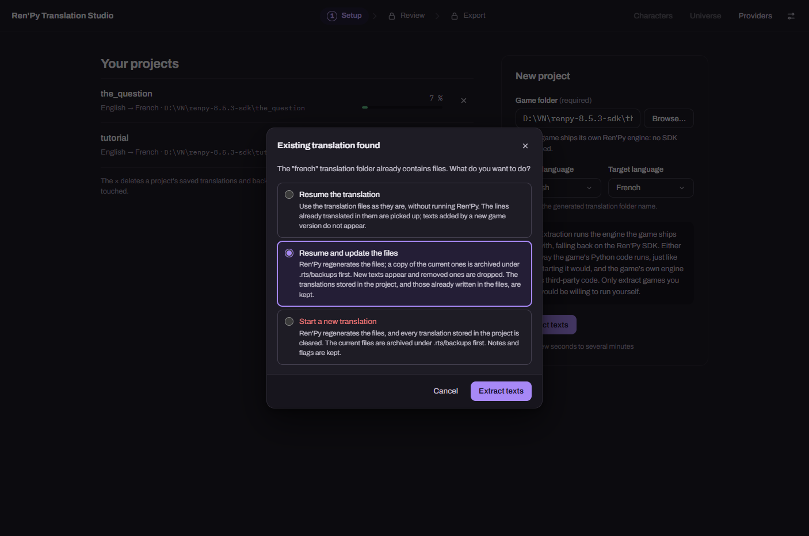

[← Documentation](README.md)

# Project setup

*[Version française](../fr/project-setup.md)*

The first screen after launch. It lists the games you already set up, and
offers the form to add one.

## Your projects

Each entry shows the folder name, the source and target languages, the
path and how far along it is (the percentage of validated lines). Clicking
one reopens it straight in the review screen. An entry that was never
extracted reads *Not extracted yet* and cannot be opened.

The × deletes the project's data after a confirmation: the translations
stored in the game's `.rts` folder, the backups kept there, and the entry
itself. The game's own files, `game/tl/` included, are never touched. This
cannot be undone. If a file of that folder is in use by another program,
the deletion fails and says so.

This list is also what the [MCP server](mcp-server.md) is allowed to open:
a folder that is not in it cannot be reached by an assistant.

## A new project

**Game folder** — the root of the Ren'Py game, the folder *containing*
`game/`, not `game/` itself. The application checks it as soon as you pick
it and says whether the folder looks like a Ren'Py game.

**Source language** — the language the game is written in. English in
almost every case.

**Target language** — the language you are translating into. This is also
the name of the folder Ren'Py will generate, `game/tl/<language>/`, so it
has to be a language Ren'Py knows. When the game already holds exactly one
translation folder, it is selected for you.

**Ren'Py SDK** — this field only appears when the game's own engine
cannot run on this system. See below and [Installation](installation.md).

### Which Ren'Py runs the extraction

A packaged Ren'Py game ships its own engine, the version its scripts were
written for. The application uses it first: the form then reads *The game
ships its own Ren'Py engine: no SDK needed.* and the SDK is not asked for.

The SDK is only the fallback, for a game whose engine cannot run here, for
instance a Windows-only build opened on Linux. The field then appears and
the extraction waits until you have selected the launcher (`renpy.exe` or
`renpy.py`). The choice is remembered.

> Extraction runs the game's own engine, or failing that the SDK. Either
> way the game's Python code runs, exactly as when you start the game, and
> a game's engine is third-party code. Only extract games you would be
> willing to run yourself. The form repeats this above the button.

## Extraction

**Extract texts** runs Ren'Py's own `translate` command in a subprocess.
Ren'Py walks the game's scripts and writes `game/tl/<language>/`, and the
application reads those files back and stores one row per translatable
block in `<game>/.rts/translations.db`. A progress line names the stage:
archiving the existing folder, unpacking archived sources, running Ren'Py,
reading the generated files, updating the project.

Expect anything from a few seconds to several minutes on a large game: it
is the game's engine parsing the whole script, not a text search. Ren'Py
is stopped if it exceeds the allowed time; extract again, the files it had
already written are kept.

Scripts packed in `.rpa` archives are invisible to `translate`, so the
application first unpacks the `.rpy` sources of those archives into
`game/`, without overwriting anything already there. They are removed
again once you export the zip.

### A folder that already has a translation

When `game/tl/<language>/` already holds `.rpy` files, the application asks
what to do:

- **Resume the translation** — use the files as they are, without running
  Ren'Py. The lines already translated in them are picked up; texts added
  by a new version of the game do not appear.
- **Resume and update the files** (the default) — Ren'Py regenerates the
  files, after a copy of the current ones has been archived under
  `.rts/backups`. New texts appear and those the game dropped are removed.
  The translations stored in the project, and those already written in the
  files, are kept.
- **Start a new translation** — Ren'Py regenerates the files and every
  translation stored in the project is cleared. The current files are
  archived under `.rts/backups` first. Notes and flags are kept.

### What can go wrong

- **A source file is rejected.** Ren'Py reports a parse error and the
  lines of that file are absent from the extraction. For a source unpacked
  from an archive, the application names the files it had to leave out
  once the extraction ends; the game still runs, falling back on the
  compiled version of each. That is the usual symptom of an SDK of the
  wrong generation reading an older game, which is why the game's own
  engine comes first.
- **No engine at all.** The game ships no engine, or only one for another
  system, and no SDK is selected. The message says which of the two it is.
- **Only compiled scripts.** The archives hold `.rpyc` files and no
  `.rpy`; there is nothing to translate until the game is decompiled,
  which this application does not do.
- **Only the engine's own strings.** Only `common.rpy` came out, with no
  dialogue: check that the folder is the game's own project.
- **No translation blocks found.** Check that the game folder is correct.
- **The archive folder is in use.** Close the game, your editor, or any
  file manager or terminal open inside `game/tl/`, then try again.

### Re-extracting

Re-running extraction on a project that already has one **never
overwrites your work**. Blocks are matched by their stable Ren'Py
identifier, new ones are added, and existing translations stay where they
are. Lines whose source text changed in the game are re-synchronised, and
only their unvalidated translations are dropped: anything you validated is
kept, and the line stays where it was for a second look.

When the game renumbers a block but keeps its text, the translation moves
to the new block if that one is still untranslated; a text shared by
several lines comes through as *Imported*, never as validated. A block the
game really dropped is deleted with its translation. As a safeguard, an
extraction that finds less than half of the stored lines deletes nothing.

## Where things are stored

| What | Where |
|---|---|
| Translations, statuses, notes | `<game>/.rts/translations.db` (SQLite) |
| Backups of replaced `tl/` files | `<game>/.rts/backups/` |
| Generated Ren'Py files | `<game>/game/tl/<language>/` |
| Settings, project list, translation memory | The OS configuration directory |
| API keys | The OS keyring, never a file |

The database lives inside the game folder, so moving or copying that
folder carries the whole translation with it. It is opened in WAL mode,
which means the MCP server can work on the same project at the same time;
two sidecar files, `translations.db-wal` and `-shm`, appear next to it.
