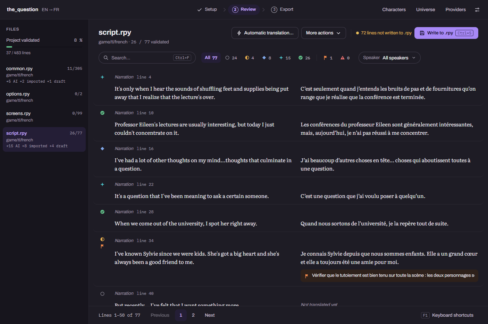
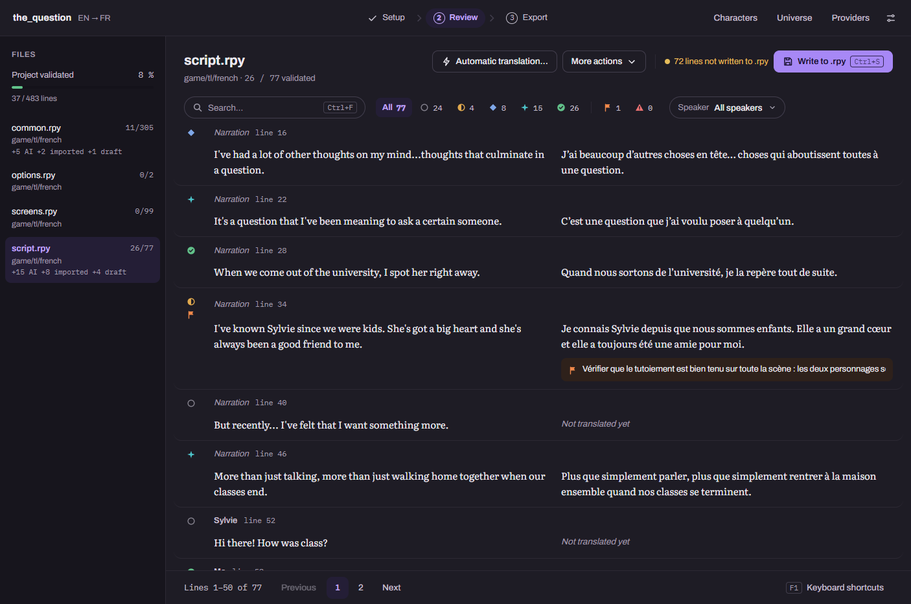
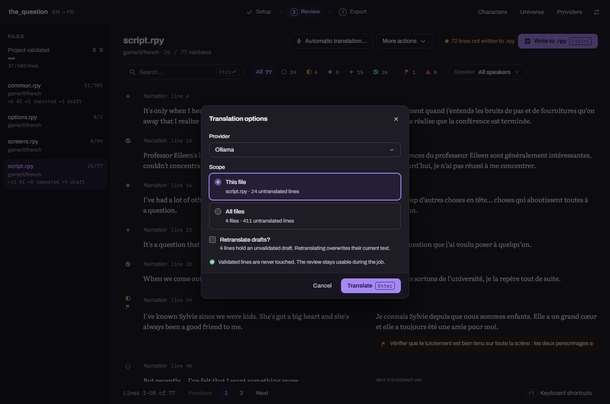
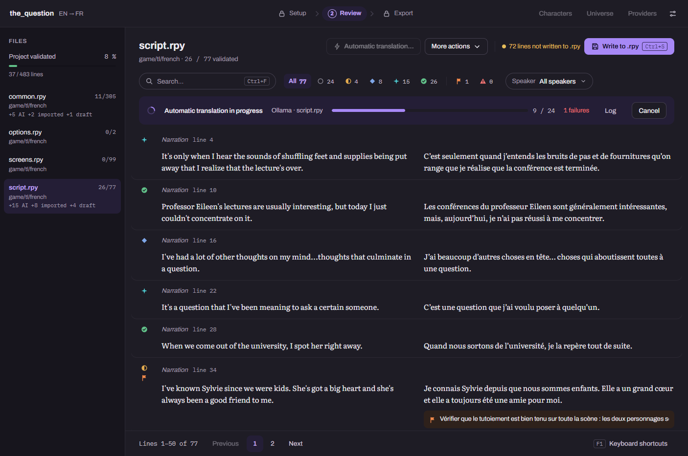
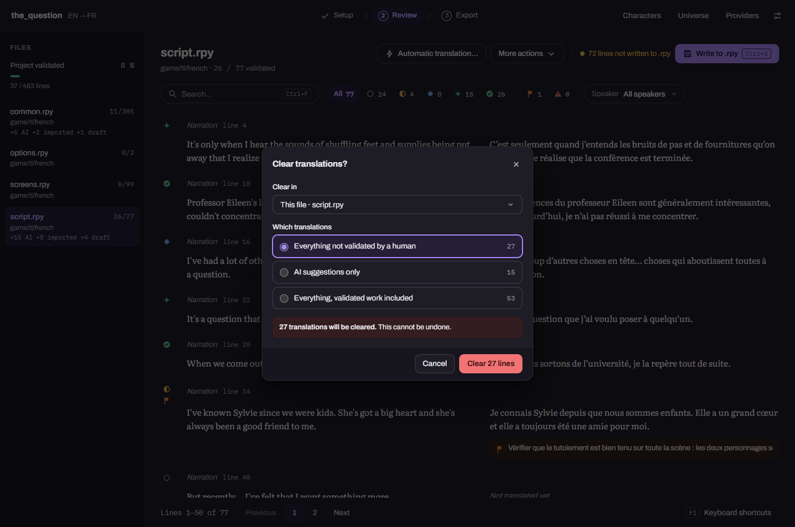

[← Documentation](README.md)

# Review screen

*[Version française](../fr/review-screen.md)*

Where the work happens. Everything else in the application is reached from
here.

## The file panel

On the left, one entry per `.rpy` file the extraction produced, with a
progress bar for the whole project above them (*Project validated*, in
percent and in lines).

Each file shows its name, its folder (or *game root*) and its counts:
validated over total, then how many lines are AI suggestions, imported, or
drafts (`+4 AI`, `+2 imported`, `+1 draft`). A file at `0/99` has not been
started; `26/77` means twenty-six lines validated out of seventy-seven.
While a filter or a search is active, each file also shows how many of its
lines match, and files with no match are dimmed.

Right-clicking a file, or pressing the **Menu** key (or `Shift+F10`) while
it is selected, offers six actions on that file alone: *Open*, *Copy path*,
*Reveal in file manager*, *Translate this file…*, *Import / export…* (the
[bilingual file](bilingual-files.md)) and *Clear translations…*.

`common.rpy` is usually the largest file and the least interesting: it
holds Ren'Py's own interface strings rather than the game's dialogue.

## Filters

**Status** is a row of buttons that filters the lines of the open file:
*All*, *Not translated*, *Draft*, *Imported*, *AI suggested* and
*Validated*, then two extra views after a separator: *Flagged*, for lines
someone marked for a second look, and *In error*, for translated lines a
quality check refuses. Except for *All*, the buttons show the status
glyph; hover one to read its name. Each carries the number of matching
lines in the open file.

**Speaker** filters by character. The menu only appears when the game has
speakers; it lists the characters by the display name set in the
[Characters](context-for-the-ai.md) screen, or by their variable name in
the game's scripts when none is set. Useful to keep one character's
register consistent, or to translate all of one person's lines in a row.
Lines nobody speaks are shown as *Narration*.

**Search** (`Ctrl+F`) matches both the source and the translation, so it
finds a term you used as well as a term you are looking to translate.
`%` and `_` are searched literally.

The count under the file name — `26 / 77 validated` — always describes the
whole file, not the filter. The three filters combine, and the review
screen remembers them (and the file and page you were on) when you come
back from another screen.

Lines are shown fifty to a page; `Alt+←` and `Alt+→` turn the pages.

## The rows

Each row is one translatable block: its status glyph (with a flag glyph
when flagged and an error glyph when a validation was refused), the
speaker, the line number in the source file, the source text, and the
field you type into. The field grows with its content.

What you type is saved into the project's database as you type; the line
becomes a *Draft*. Nothing is lost if you go to another file or leave the
screen.

The five icons on the right of the row, in order (they appear when the
row is hovered or has the focus):

| Icon | Action | Shortcut |
|---|---|---|
| Translate | Translate this line alone with the default provider | |
| Copy | Copy the source text into the translation | `Ctrl+D` |
| Erase | Empty the field: the line goes back to *Not translated* | |
| Flag | Flag the line for a second look | `Ctrl+M` |
| Check | Validate | `Ctrl+Enter` |

Validating moves the cursor to the next line, or to the first line of the
next page after the last one.

If other lines in the project have exactly the same source text, a small
`↔ 3` badge appears next to the line number, with a tooltip counting them
in this file and in other files. After you validate such a line, a message
offers *Validate all*; clicking the badge does the same. Validating with
`Ctrl+Shift+Enter` applies the translation to those lines directly. On a
game full of repeated one-liners this saves a great deal of typing. Only
lines that are not yet validated receive it.

Flagging a line brings up a **note** field in a yellow band under the
translation. Notes are for whatever the text does not say by itself: a
register to check, a term to keep consistent, a line whose meaning depends
on a branch. Writing a note flags the line. Unflagging a line that has a
note asks for confirmation, because the note is deleted with the flag.
Neither the flag nor the note is ever touched by a translation job or an
import — only by a person.

When you validate, the application checks the translation against the
source:

- A **refusal** (*Validation refused.*) appears in a red band and the line
  is not validated. It happens when a `{tag}` or a `[variable]` of the
  source is missing, when the translation adds a `[variable]` the source
  does not have, or when it contains an HTML tag. An empty translation
  cannot be validated either. The blocking checks are described in
  [Troubleshooting](troubleshooting.md).
- A **warning**, such as *Translation 32% longer than source text*, is only
  advisory: the line is validated anyway.

Use the *In error* filter to list the translated lines a quality check
refuses.

When an assistant connected through the [MCP server](mcp-server.md) writes
to the project while the screen is open, the lines on screen are updated in
place and marked *Modified by the assistant* for a few seconds. The line
you are typing in is never touched, and a filter is not re-applied under
you: a line the assistant fills stays on screen even under *Not
translated*.

## The toolbar

Above the lines, the toolbar shows the open file and its validated count,
then:

**Automatic translation…** opens the translation options: the provider,
the scope (*This file*, *All files*, or *Filtered lines* when a filter is
active) and, when drafts exist in the scope, a choice to retranslate them.
It starts a background job.

A running job reports in a banner rather than a modal, so the review stays
usable while it works; the banner shows the progress, the number of
failures, a *Log* and a *Cancel* button, and *Close* once the job is
finished. By default the job only sends lines that are still *Not
translated*, which means fixing a bad suggestion by hand is safe: a later
job will not overwrite it, and will not retry it either. Lines already
validated are never touched, and lines with nothing to translate (only
symbols or punctuation) are copied and validated without being sent. While a
job runs, the other screens of the application are disabled.

**More actions** opens a menu with three entries:

- *Memory* fills the untranslated lines of the whole project from the
  [translation memory](bilingual-files.md#translation-memory).
- *Import / export…* does the [bilingual file](bilingual-files.md) round
  trip for the open file.
- *Clear…* deletes translations in bulk. The dialog asks where (this file
  or all files) and which translations: everything not validated by a
  human, AI suggestions only, or everything including validated work. It
  shows how many lines will go and cannot be undone. Flags and notes are
  kept.

**Write to .rpy** (`Ctrl+S`) writes everything back into
`game/tl/<language>/`. The counter beside it — *72 lines not written to
.rpy* — is how many edits are only in the database so far; it reads *.rpy
files up to date* otherwise. Nothing is lost if you leave without writing;
the files on disk are simply not up to date yet.

The *Characters*, *Universe* and *Providers* screens (see
[Context for the AI](context-for-the-ai.md) and
[Translation providers](translation-providers.md)) are reached from the
buttons at the top of the window, next to the steps.

## Leaving

The three steps at the top — *Setup*, *Review*, *Export* — are the way out
in both directions: *Setup* goes back to [project setup](project-setup.md),
*Export* goes forward to [export](export.md).

Going back to the setup screen asks for confirmation (*Return to setup?*),
and translations stay saved either way. Navigation away from the review
screen is refused while a translation job is running: cancel it or let it
finish.
