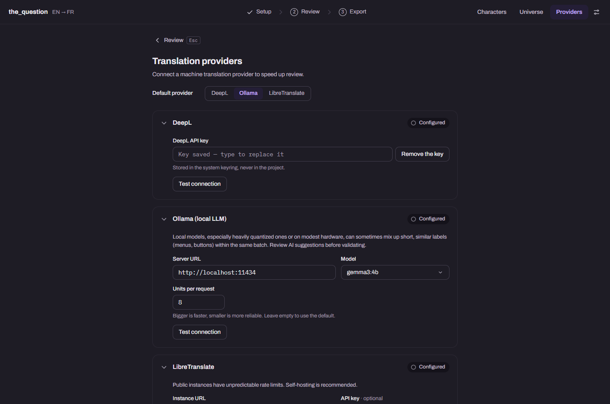
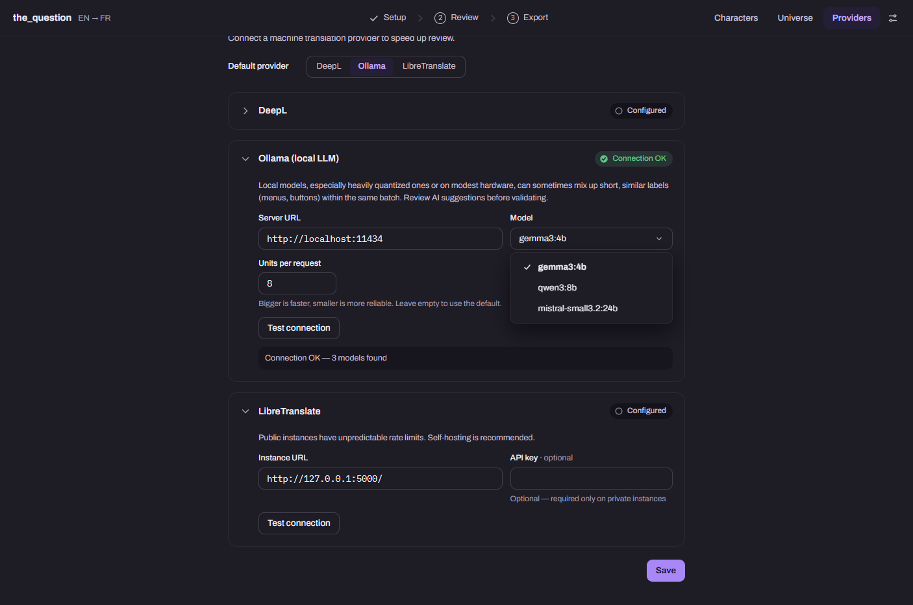

[← Documentation](README.md)

# Translation providers

*[Version française](../fr/translation-providers.md)*

Three providers, reached from the **Providers** entry in the header or from the gear icon
then **Configure a provider**. Everything is saved at once with a single
**Save** button at the bottom of the screen.

| Provider | Type | Runs | Needs |
|---|---|---|---|
| [DeepL](https://www.deepl.com) | Machine translation | Cloud | API key |
| [Ollama](https://ollama.com) | LLM | Local, or Ollama's cloud models | A pulled model |
| [LibreTranslate](https://libretranslate.com) | Machine translation | Cloud or self-hosted | URL, key if the instance asks |

Each provider has its own section with a **Test connection** button and a
badge: **Configured** when a key, model or URL is filled in, **Not configured**
otherwise, then **Connection OK** or **Error** after a test. When more than
one provider is configured, a **Default provider** selector appears at the top.

**No provider at all is a valid setup.** The application is a review tool
first; the [MCP server](mcp-server.md) is the other way to get text
translated without an API key or a GPU.

If you remember Claude and Mistral from earlier versions: they were removed
in 1.0.0 and are not available.

## Machine translation or LLM

**DeepL and LibreTranslate** translate a string at a time. They are fast,
cheap and predictable, and they know nothing about your game: no
character register, no recurring terms, no idea who is speaking.

**Ollama** receives the
[universe summary and character glossary](context-for-the-ai.md) with every
batch, so it can hold a register and keep a proper noun consistent. It
is slower and more expensive, and it can invent.

DeepL is the only one that supports a **server-side glossary**: character
notes written as `Name -> Translation` are uploaded as a real DeepL
glossary, synchronised lazily on the first batch.

Only Ollama can draft the [universe summary](context-for-the-ai.md)
for you.

## Ollama

**Server URL** — `http://localhost:11434` unless you moved it.

**Model** — press **Test connection** first; the dropdown then lists what
the daemon actually has. Ollama's cloud models go through the same local
endpoint, the daemon signing the request itself, so they are just another
name in that list; they need `ollama signin` rather than a key here.

**Units per request** — a whole number from 1 to 32; bigger is faster,
smaller is more reliable. Leave it empty for the default (8).

> The warning shown in that panel is not decorative. Heavily quantized
> local models, or modest hardware, genuinely do mix up short similar
> labels — menu entries, button captions — inside one batch. Reduce the
> batch size and review AI suggestions before validating them.

A local model needs a GPU to be comfortable. On CPU it will work and it
will be slow. During a job the review screen tells you when the model is
still loading, and when it runs partly on the CPU (reduce **Units per
request** or pick a smaller model).

Local models are given at most 8192 tokens of context, beyond which
generation collapses. Cloud models (names ending in `-cloud`) are not
capped, since nothing is loaded on your machine.

## DeepL

Paste your **DeepL API key**. **Test connection** shows how many characters
are left this month. **Remove the key** deletes it from the keyring after a
confirmation.

## LibreTranslate

**Instance URL** (for example `http://localhost:5000`) and an optional
**API key**, needed only on private instances. Public instances have
unpredictable rate limits; self-hosting is recommended. Since the service
translates one string per request, it is the slowest of the three on a large
game.

If the URL uses `http://` towards a non-local host while a key is set, a
warning tells you the key would travel unencrypted. Use `https://` or a
local address.

## When a provider refuses

A rejected key (401, 403), an exhausted DeepL quota (456) or a rate limit
(429) stops the job instead of failing line after line. What was already
translated is kept. A rate limit is retried first, waiting a few seconds
between attempts, before the job gives up. Fix the key or wait, then start
again: only lines still not translated are sent.

## API keys

Keys are stored in the **operating system keyring**, not in the settings
file and not in the project. They are never logged, not even partially,
and never included in an error message. If the machine has no keyring,
saving a key fails with an explicit message.

## Verbose logging

The **Verbose logging** switch in the settings dialog (gear icon) writes
more detail to the application log, which **Open the log** shows. It is the
first thing to turn on when a translation comes back wrong or a connection
fails.

## Adding a provider

Providers live under `rust/src-tauri/src/core/translation/providers/`.
Adding one means a module there, an entry in the registry, its keys in the
settings, its section in the provider screen, its strings in both locales,
and mocked tests. See [rust/README.md](../../rust/README.md).
