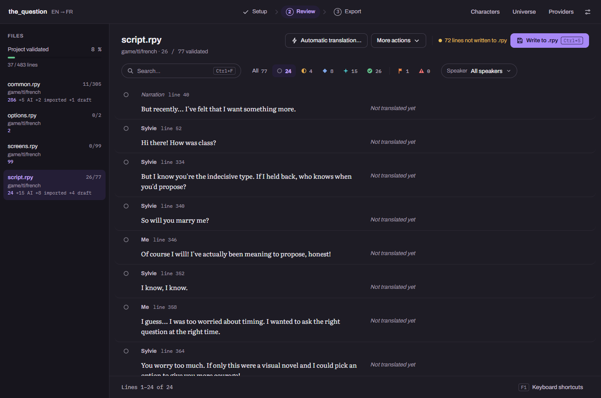
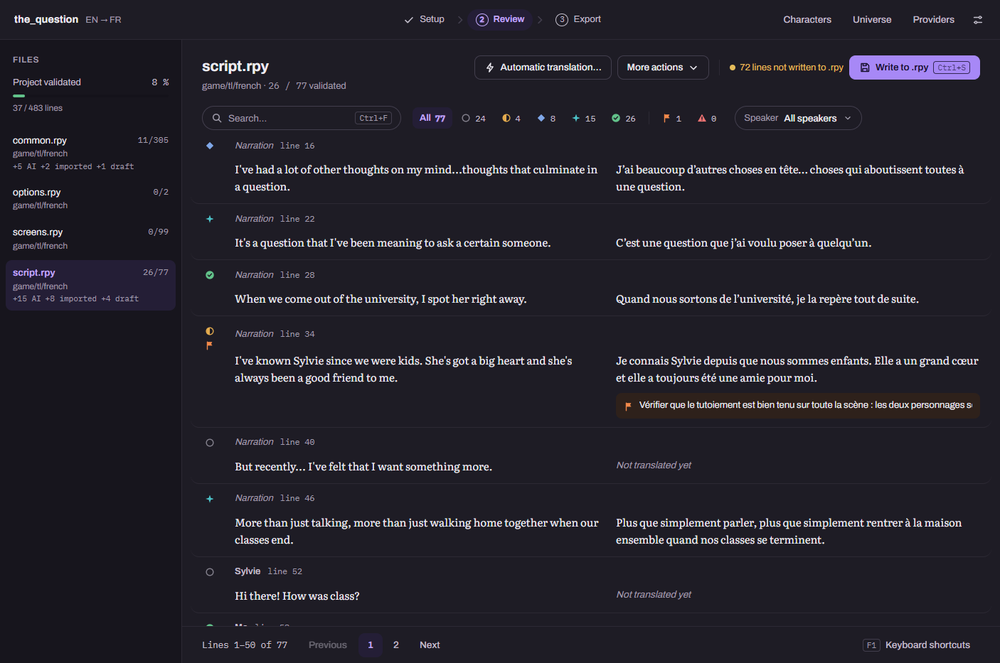

[← Documentation](README.md)

# Translation statuses

*[Version française](../fr/translation-statuses.md)*

Every line carries exactly one of five statuses, plus an independent flag.

## The five statuses

| Status | Meaning | Set by |
|---|---|---|
| **Not translated** | No translation yet | The extraction |
| **Draft** | Edited by hand, not validated | You, by typing |
| **Imported** | Came from elsewhere, unread here | Translations already found in `tl/` at extraction, bilingual file import, translation memory |
| **AI suggested** | A provider or an assistant proposed it | A translation job, the MCP server |
| **Validated** | A human read it and said yes | You, `Ctrl+Enter` |

They are a pipeline, roughly `not_translated → ai_suggested →
human_validated`, with `draft` and `imported` as the two side entrances.

A line whose source has nothing to translate (only symbols or
punctuation) is the one exception: it is copied as is and validated
automatically, since there is nothing for a human to review.

## The rules that matter

**A validated line is protected.** A translation job, the translation
memory, the propagation to identical lines and a submission from the MCP
server all leave it alone. An import only replaces it with a line that is
itself marked validated in the file. A server started with
`--allow-overwrite-validated` may replace it, and the line then becomes a
draft. What un-validates a line otherwise is you: typing in its field turns
it into a draft, the erase button resets it, and the *Clear* dialog can
reach validated lines if you choose *Everything, validated work included*.

**Jobs only touch untranslated lines.** A translation job sends nothing
else, unless you ask it to retranslate drafts or run it on a filter (which
still skips validated lines). So a wrong AI suggestion stays wrong until
someone deals with it — running the job again will not retry it. Clear it,
or fix it, or filter on *AI suggested* and go through them.

**Emptying a field resets the line.** A draft whose text you delete goes
back to `not_translated`, which puts it back in reach of the next job.

**Validation is a gate.** Validating a line runs the quality checks, and a
translation that drops a `{tag}` or a `[variable]`, adds a `[variable]`
the source does not have, or contains an HTML tag is refused (see
[Review screen](review-screen.md#the-rows)). The same checks apply to what
the MCP server submits and to what a bilingual file brings back: a line the
checks refuse comes in as a draft rather than validated.

## Flag and note

Beside the status sits a **flag** — *look at this again* — and an optional
**note**. They are deliberately not statuses:

- They survive everything. A job, an import, a bulk clear, a
  re-extraction: none of them clears the flag or note of a line that is
  still in the game.
- They are orthogonal to progress. A line can be flagged while
  untranslated, while validated, or anywhere between.
- Writing a note raises the flag automatically. Nothing lists notes on
  their own, so an unflagged note would be findable only by whoever
  remembered which line carried it.

Filter on *Flagged* to work through them.

## Where the statuses show up

- **In the file panel**, as the per-file counts.
- **In the row**, as the glyph in the left column. Each one has a
  distinct shape and a screen-reader label, so the information never
  depends on colour alone.
- **In the export**, indirectly: everything with text is written to the
  `.rpy` files, whatever its status. The statuses describe your confidence,
  not what ships.
