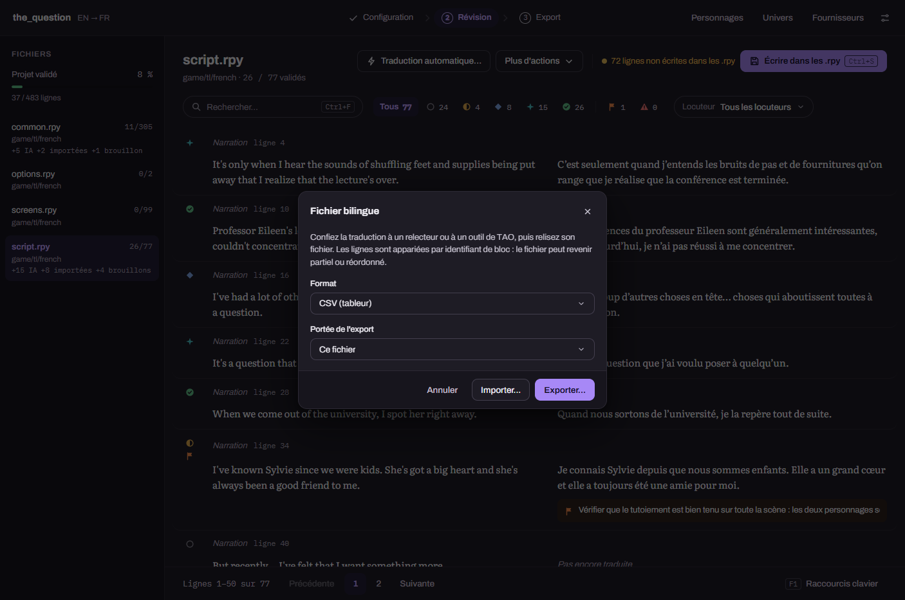

[← Documentation](README.md)

# Fichiers bilingues

*[English version](../en/bilingual-files.md)*

Deux façons de faire entrer et sortir des traductions sans toucher aux
fichiers du jeu : un fichier que vous envoyez à quelqu'un, et une mémoire
partagée entre vos propres projets.

## Import et export

Accessible depuis **Import / export…** dans le menu **Plus d'actions** de
la barre d'outils de la révision, ou depuis **Importer / exporter…** dans le
menu contextuel d'un fichier.

| Format | Pour |
|---|---|
| **CSV (tableur)** | Un tableur. Le format qu'un relecteur sans outil particulier acceptera. |
| **XLIFF 1.2 (OmegaT, memoQ)** | Un outil de TAO — OmegaT, memoQ, Trados. |
| **JSON** | Un script à vous. |

**Portée de l'export** : soit **Ce fichier** (le fichier affiché), soit
**Tous les fichiers**. **Exporter…** demande où enregistrer le fichier ;
toute la portée part, lignes non traduites comprises, puisque c'est
précisément fait pour être confié à un traducteur. Les fichiers sources sont
écrits avec un chemin relatif au dossier du jeu.

**Importer…** accepte les fichiers `.csv`, `.xlf`, `.xliff` et `.json`,
encodés en UTF-8. Avant d'écrire quoi que ce soit, un dialogue de
confirmation indique combien de traductions vont être écrites et compte ce
qui sera laissé de côté.

### Le retour

Les lignes sont appariées par **identifiant de bloc**, jamais par position.
Cela a une conséquence sur laquelle on peut compter : le fichier peut
revenir **partiel ou réordonné** et s'importer quand même correctement. Un
relecteur peut supprimer les lignes sur lesquelles il n'avait rien à dire,
trier la feuille par locuteur, ou ne renvoyer que le premier chapitre.

Chaque ligne emporte aussi le texte source avec lequel elle a été exportée.
Si le texte du jeu a changé depuis l'export, la ligne est ignorée plutôt
qu'appariée à un texte pour lequel elle n'a pas été écrite.

Toute traduction qui revient modifiée est écrite en **importé**, quel que
soit le statut que lui donne le fichier : la colonne *status* en CSV et en
JSON, ou l'état `state` en XLIFF, n'est pas prise en compte. Un fichier
vient de l'extérieur et personne ne l'a relu *ici* : il ne peut donc ni
valider une ligne, ni faire passer le texte d'un relecteur pour une
*suggestion IA*.

- Une ligne que vous avez validée n'est jamais remplacée par un import.
  Corrigez-la dans l'écran de révision si le relecteur a raison.
- Une traduction identique à celle du projet ne change rien : un fichier
  exporté puis réimporté sans modification laisse le projet tel qu'il
  était.

> Un fichier importé est une entrée non fiable. Une ligne qui ajoute une
> `[interpolation]` Ren'Py absente de la source est refusée d'emblée :
> Ren'Py l'exécuterait comme du code. Les autres contrôles qualité (une
> `{balise}` ou une `[variable]` perdue) s'appliquent quand vous validez la
> ligne, comme pour toute autre. Voir [Dépannage](troubleshooting.md).

Le dialogue de confirmation et le récapitulatif qui suit nomment chaque cas :

| Le récapitulatif dit | Signification |
|---|---|
| *inconnues dans ce projet* | L'identifiant de bloc n'existe pas dans ce projet (typiquement un fichier venu d'un autre jeu). Ignorées. |
| *dont le texte source a changé depuis l'export* | Ignorées. |
| *sans traduction* | La ligne est revenue vide. Ignorée : ce que le projet contient n'est pas effacé. |
| *déjà validées, laissées intactes* | Une ligne validée que le fichier aurait modifiée. Non écrites. |
| *refusées, ajoutant une interpolation absente de la source* | Non écrites. |

### Précautions pour les tableurs

Le texte d'un jeu n'est pas fiable, et une réplique comme `=HYPERLINK(...)`
ou `-- Hello` est une formule pour un tableur. Dans un export CSV, toute
cellule qui commence par `=`, `+`, `-` ou `@` (ou par une tabulation ou un
retour chariot) reçoit une apostrophe en tête, que l'import retire. Le
fichier est en UTF-8 avec marque d'ordre des octets, ce qui permet à Excel
d'ouvrir correctement les traductions accentuées.

Le XLIFF est lu sans jamais développer d'entité : un document qui en
déclare une est refusé.

## Mémoire de traduction

**Mémoire**, dans le menu **Plus d'actions** de la barre d'outils de la
révision, remplit les lignes non traduites depuis un stock partagé par tous
les projets de cette machine.

- Elle est alimentée **par les seules validations humaines**. Rien de ce
  qu'un fournisseur a suggéré n'y entre avant que vous ayez dit oui.
- Elle répond pour une **paire de langues**, sur le texte source tel qu'il
  est écrit, puis sur un texte quasi identique : la casse, les espaces
  répétés et la ponctuation finale sont ignorés. Les `[variables]` et les
  `{balises}` doivent correspondre exactement.
- Elle remplit **tout le projet**, jamais un seul fichier : la mémoire
  répond pour une paire de langues, et une portée par fichier ne ferait que
  vous obliger à parcourir chaque fichier pour arriver au même résultat.
- Elle ne touche que les lignes *Non traduit*, elle n'a donc besoin
  d'aucune confirmation, et ce qu'elle écrit arrive en **importé**.

Elle devient payante à partir du deuxième jeu d'une série, et sur les
chaînes d'interface de `screens.rpy` et `common.rpy`, quasi identiques d'un
jeu à l'autre.

Le dialogue des paramètres indique, pour chaque paire de langues, combien
d'entrées la mémoire contient, et permet d'oublier une paire. Les projets
gardent alors leurs propres traductions.
