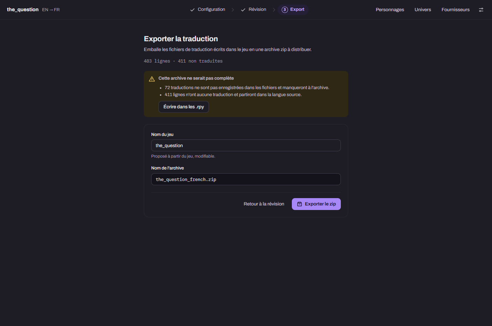

[← Documentation](README.md)

# Export

*[English version](../en/export.md)*

Deux étapes distinctes : écrire les fichiers `.rpy`, puis les empaqueter
dans un zip.

## Écrire les fichiers .rpy

**Enregistrer dans .rpy**, dans la barre d'outils de la révision
(`Ctrl`+`S`). À côté, un compteur indique combien de lignes n'existent
encore que dans la base (*N lignes non écrites dans les .rpy*), ou que les
*fichiers .rpy sont à jour*.

L'écriture réécrit `game/tl/<langue>/`, en appariant les blocs de dialogue
par leur **identifiant de bloc** Ren'Py et les blocs `strings` par leur
texte `old` — jamais par position. Avant de modifier un fichier, sa version
précédente est copiée dans `<jeu>/.rts/backups/`.

C'est cette étape qui rend la traduction réelle : tout ce qui précède vit
dans `<jeu>/.rts/translations.db`, dont Ren'Py ignore l'existence. Toute
ligne portant du texte est écrite, quel que soit son
[statut](translation-statuses.md). Si rien n'est encore traduit, il n'y a
rien à enregistrer et l'application le dit.

## Le zip

Accessible depuis l'étape **Export** de la barre de progression, en haut de
l'écran.



L'écran indique combien de lignes le projet contient et combien ne sont pas
traduites. Deux champs préparent l'archive :

- **Nom du jeu** — proposé à partir du jeu (le `build.name` de son
  `options.rpy`, à défaut le nom du dossier), et modifiable.
- **Nom de l'archive** — en lecture seule, déduit du nom du jeu et de la
  langue cible, sous la forme `<nom du jeu>_<langue>.zip`.

**Exporter le zip** demande où enregistrer l'archive. Elle a la structure
qu'un joueur s'attend à déposer dans un jeu :

```
<nom du jeu>/game/tl/<langue>/
```

Les fichiers `.rpyc` sont exclus : c'est la sortie compilée de Ren'Py, que
le moteur régénère. Toute entrée dont le chemin contient `../` est refusée
plutôt qu'écrite, de même qu'un nom de jeu vide, égal à `.` ou `..`, ou qui
contient une barre oblique, une barre oblique inverse ou deux-points (un nom
vide devient `game`). L'archive est écrite sous un nom temporaire puis mise
en place à la fin : un export qui échoue ne laisse pas de zip partiel.

Une fois le zip écrit, les sources dépaquetées depuis les archives `.rpa` du
jeu pour l'extraction sont retirées de `game/`.

### Quand l'archive ne serait pas complète

Si quelque chose cloche, un dialogue intitulé *Cette archive ne serait pas
complète* le liste avant que quoi que ce soit soit écrit :

- aucune traduction n'a jamais été écrite dans les fichiers `.rpy` : l'archive
  ne contiendrait que la langue source ;
- des traductions ne sont pas encore enregistrées dans les fichiers et
  manqueraient à l'archive ;
- les fichiers `tl/` ont été modifiés en dehors de l'application depuis le
  dernier enregistrement, et ces retouches seront écrasées au prochain ;
- des lignes n'ont aucune traduction et partiront dans la langue source ;
- des lignes présentent un problème de qualité (une balise perdue ou une
  interpolation ajoutée), avec les fichiers qui en comptent le plus nommés.

**Exporter quand même** passe outre. La même liste apparaît sur l'écran
d'export, avec un bouton **Écrire dans les .rpy** quand un enregistrement
suffirait à régler le problème : utilisez-le d'abord.

Tant qu'un travail de traduction tourne, les autres étapes de la barre de
progression sont indisponibles : annulez-le ou laissez-le finir avant
d'exporter.

## L'envoyer

Le dossier `tl/` produit part chez les joueurs du jeu : c'est pour cela que
les [contrôles qualité](troubleshooting.md) sur les interpolations sont des
refus et non des avertissements. Ren'Py évalue ce qui se trouve entre
crochets comme une expression Python.
