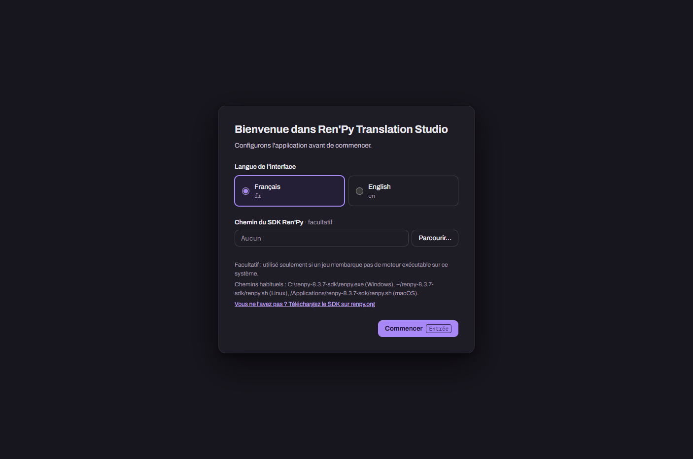
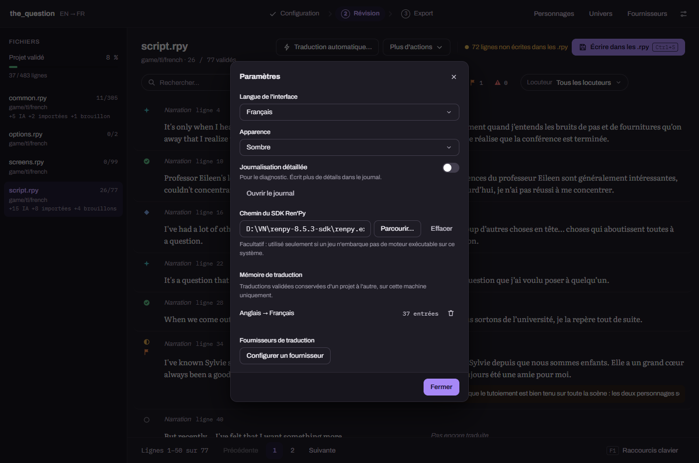

[← Documentation](README.md)

# Installation

*[English version](../en/installation.md)*

## Ce qu'il faut

- **L'installateur de votre système**, ou le code source si vous préférez
  compiler l'application vous-même (voir la fin de cette page). Rien
  d'autre à installer avant : ni Python, ni environnement d'exécution.
- **Un moteur Ren'Py pour extraire.** Vous en avez sans doute déjà un :
  voir plus bas.
- **Un compte ou un point d'accès de fournisseur**, seulement si vous
  voulez de la traduction automatique ou LLM. L'application est
  parfaitement utilisable comme simple outil de révision sans aucun.

### À propos du moteur Ren'Py

L'extraction lance la commande `translate` de Ren'Py : il faut donc que
quelque chose fournisse cette commande. Deux sources, dans cet ordre :

1. **Le moteur embarqué dans le jeu.** Un jeu Ren'Py packagé embarque son
   propre moteur, dans la version exacte pour laquelle ses sources ont été
   écrites. C'est le bon par construction, et c'est celui qui est utilisé
   dès que ce système peut l'exécuter.
2. **Un SDK Ren'Py installé**, en recours. Nécessaire quand le moteur du
   jeu ne peut pas tourner ici — un build `-win` ouvert depuis Linux, par
   exemple, puisqu'il ne contient que des runtimes Windows.

Le SDK est donc **facultatif**. Renseignez-le plus tard, depuis le
dialogue des paramètres, si un jeu finit par le réclamer.

> La version compte. Ren'Py 8 refuse une syntaxe d'écran que Ren'Py 7
> acceptait, et chaque fichier source refusé retire ses lignes de
> l'extraction. Mesuré sur un vrai jeu : le SDK 8.5.3 a rejeté 3 sources
> et produit 40 739 unités, là où le moteur 7.5.3 du jeu n'en a rejeté
> aucune et produit 40 820.

> Lancer le moteur du jeu, c'est exécuter du code tiers — l'exécutable même
> que vous lanceriez pour jouer. N'extrayez que des jeux que vous
> accepteriez de lancer.

## Obtenir l'application

Les installateurs sont produits par le workflow **Rust** du dépôt, un
runner par système, et publiés en artefacts de son exécution (onglet
Actions du dépôt). Un artefact par système :

| Système | Artefact  | Contenu                                   |
|---------|-----------|-------------------------------------------|
| Windows | `windows` | un installateur NSIS (`.exe`)             |
| Linux   | `linux`   | un paquet Debian (`.deb`) et une AppImage |

L'application installée s'appelle **Renpy Translation Studio** (le titre
de la fenêtre garde l'apostrophe : Ren'Py Translation Studio). Elle
embarque `rts-mcp`, le serveur MCP, à côté de son propre exécutable : voir
[Serveur MCP](mcp-server.md).

Sous Linux, l'AppImage doit être rendue de nouveau exécutable après le
téléchargement (`chmod +x`), le téléchargement d'un artefact perdant les
droits d'accès.

Ces installateurs ne sont pas signés : le système d'exploitation peut vous
avertir la première fois que vous les lancez.

## Premier lancement



Deux choses sont demandées, et les deux se changent ensuite :

- **Langue de l'interface** — anglais ou français.
- **Chemin du SDK Ren'Py** — facultatif, comme expliqué plus haut.
  Laissez-le vide jusqu'à ce qu'un jeu en ait besoin. Le champ indique si
  le chemin désigne bien un exécutable Ren'Py (*SDK trouvé* ou *Aucun
  exécutable Ren'Py trouvé à ce chemin*).

Cliquez sur **Commencer** pour continuer.

Tout le reste se règle depuis l'icône d'engrenage (**Paramètres**) dans
l'en-tête.



Le dialogue contient :

- **Langue de l'interface**.
- **Apparence** — *Sombre*, *Clair* ou *Comme le système*, appliqué
  immédiatement.
- **Journalisation détaillée** — écrit plus de détails dans le journal,
  pour le diagnostic. **Ouvrir le journal** le montre dans votre
  explorateur de fichiers.
- **Chemin du SDK Ren'Py**.
- **Mémoire de traduction** — les traductions validées conservées d'un
  projet à l'autre sur cette machine, par paire de langues, que vous
  pouvez oublier une paire à la fois.

Les clés API ne sont pas stockées dans le fichier des paramètres : elles
vont dans le trousseau du système d'exploitation (Gestionnaire
d'identifiants de Windows, Trousseau d'accès de macOS, Secret Service sous
Linux). Sans trousseau, l'application ne peut pas enregistrer de clé.

## Où se trouvent les fichiers

| Quoi                                                        | Où                                                        |
|-------------------------------------------------------------|-----------------------------------------------------------|
| Paramètres, projets récents, mémoire de traduction, journal | le dossier de configuration de l'application (ci-dessous) |
| Les traductions d'un projet                                 | `<jeu>/.rts/translations.db`                              |

Le dossier de configuration est :

- **Windows** : `%LOCALAPPDATA%\renpy-translation-studio\`
- **macOS** : `~/Library/Application Support/renpy-translation-studio/`
- **Linux** : `~/.config/renpy-translation-studio/`

On y trouve `settings.json`, `projects.json` (les projets récents, qui
sont aussi ceux que le serveur MCP a le droit d'ouvrir) et
`renpy-translation-studio.log`. Le journal ne reçoit que les diagnostics
de l'application elle-même, jamais de clé API, et passe dans
`renpy-translation-studio.log.1` dès qu'il dépasse 5 Mo.

### Venant de la 1.x

Les paramètres, les projets et la mémoire de traduction de la version 1.x
sont relus tels quels : ouvrez l'application et vos projets récents sont
là. Claude et Mistral, que la 1.0.0 avait déjà retirés, ne reviennent pas ;
DeepL, Ollama et LibreTranslate sont les trois fournisseurs.

## Compiler depuis les sources

Il vous faut [Node.js](https://nodejs.org/) 22, une chaîne
[Rust](https://rustup.rs/) stable et, sous Linux, les bibliothèques dont
Tauri a besoin (`libwebkit2gtk-4.1-dev`, `libayatana-appindicator3-dev`,
`librsvg2-dev`, `libxdo-dev`, `libssl-dev`, `libdbus-1-dev`,
`pkg-config`, `patchelf`).

```bash
git clone https://github.com/lambda-vn/renpy-translation-studio.git
cd renpy-translation-studio/rust
npm install
```

Lancer l'application en mode développement :

```bash
npm run tauri dev
```

Construire l'installateur du système sur lequel vous êtes (long : il
compile en mode release et construit aussi `rts-mcp`) :

```bash
npm run bundle
```

Tauri ne compile pas en croisé : chaque système construit son propre
installateur, d'où un runner par système dans le workflow.
