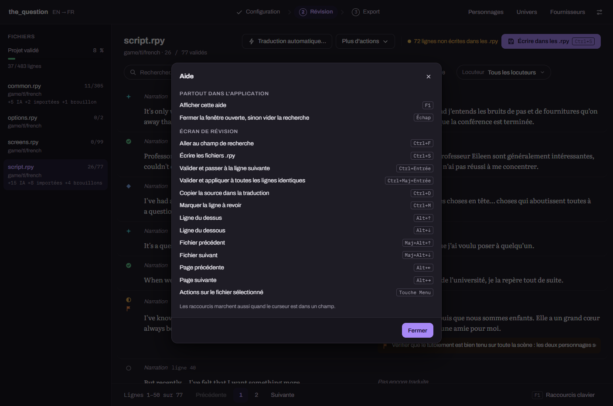

[← Documentation](README.md)

# Raccourcis clavier

*[English version](../en/keyboard-shortcuts.md)*

`F1` affiche cette liste dans l'application, depuis n'importe quel écran.

## Partout

| Touche | Action |
|---|---|
| `F1` | Afficher cette aide |
| `Échap` | Fermer la fenêtre ouverte, sinon vider la recherche |

## Écran de révision

| Touche | Action |
|---|---|
| `Ctrl+F` | Aller au champ de recherche |
| `Ctrl+S` | Écrire les fichiers `.rpy` |
| `Ctrl+Entrée` | Valider et passer à la ligne suivante |
| `Ctrl+Maj+Entrée` | Valider et appliquer à toutes les lignes identiques |
| `Ctrl+D` | Copier la source dans la traduction |
| `Ctrl+M` | Marquer la ligne à revoir |
| `Alt+↑` / `Alt+↓` | Ligne du dessus / du dessous |
| `Maj+Alt+↑` / `Maj+Alt+↓` | Fichier précédent / suivant |
| `Alt+←` / `Alt+→` | Page précédente / suivante |
| Touche `Menu` | Actions sur le fichier sélectionné |

Sur macOS, `Ctrl` devient `⌘`, `Maj` devient `⇧` et `Alt` devient `⌥`.

## Menus et listes

Les listes déroulantes (le filtre de locuteur, le choix du fournisseur ou
des langues, les actions d'un fichier) s'ouvrent avec `Espace` ou `Entrée`
sur leur bouton, pas avec la flèche du bas. Une fois la liste ouverte, `↑`
et `↓` s'y déplacent, `Début` et `Fin` sautent à la première et à la
dernière entrée, une lettre saute à l'entrée suivante qui commence par
elle, `Entrée` ou `Espace` choisit l'entrée et `Échap` ferme la liste sans
rien choisir. Les actions d'un fichier s'ouvrent aussi avec `Maj+F10`.

## Remarques

`Ctrl+Maj+Entrée` est celui à retenir sur un jeu plein de répliques
répétées — un `"..."`, un `"Oui."`, un libellé de menu qui revient à vingt
endroits.

Les raccourcis se déclenchent même quand un champ de texte a le focus :
vous n'avez donc jamais à quitter la traduction que vous êtes en train
d'écrire pour la valider. Dans un champ de traduction, `Échap` quitte le
champ (en gardant ce que vous avez tapé). Les raccourcis de la révision sont
inactifs tant qu'un dialogue est ouvert.

Toute l'application se pilote au clavier, et les statuts portent un glyphe
distinct et un libellé pour lecteur d'écran plutôt que de reposer sur la
couleur.
