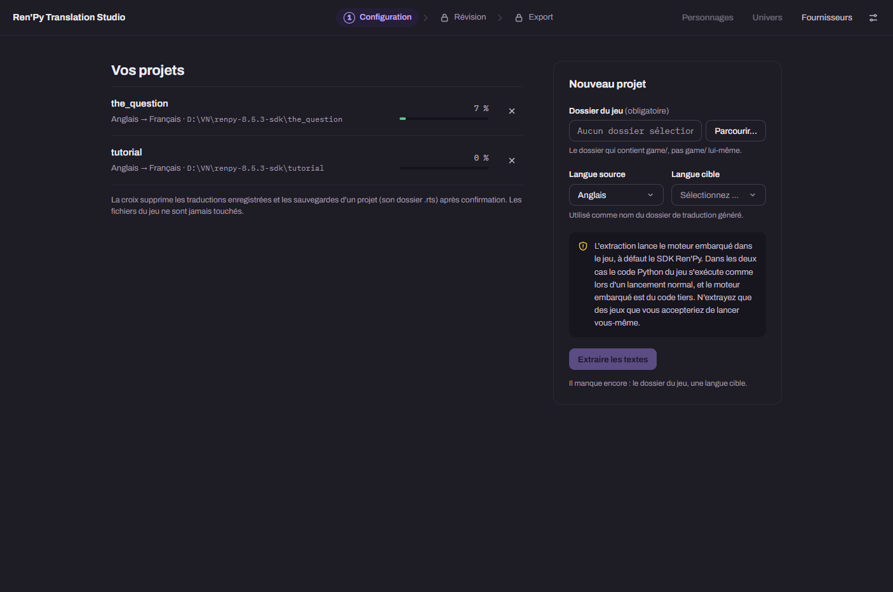
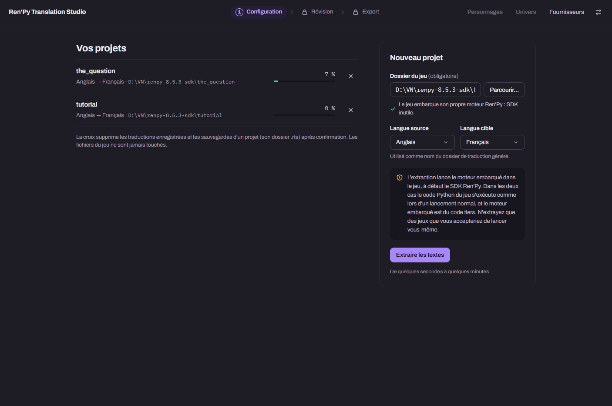

[← Documentation](README.md)

# Configuration du projet

*[English version](../en/project-setup.md)*

Le premier écran après le lancement. Il liste les jeux déjà configurés et
propose le formulaire pour en ajouter un.

## Vos projets

Chaque entrée montre le nom du dossier, les langues source et cible, le
chemin et l'avancement (le pourcentage de lignes validées). Cliquer dessus
rouvre le projet directement dans l'écran de révision. Une entrée jamais
extraite affiche *Pas encore extrait* et ne s'ouvre pas.

La croix supprime les données du projet après confirmation : les
traductions enregistrées dans le dossier `.rts` du jeu, les sauvegardes qui
y sont conservées, et l'entrée elle-même. Les fichiers du jeu, `game/tl/`
compris, ne sont jamais touchés. Cette action est irréversible. Si un
fichier de ce dossier est utilisé par un autre programme, la suppression
échoue et le dit.

Cette liste est aussi ce que le [serveur MCP](mcp-server.md) a le droit
d'ouvrir : un dossier qui n'y figure pas est inatteignable par un
assistant.

## Un nouveau projet

**Dossier du jeu** — la racine du jeu Ren'Py, le dossier qui *contient*
`game/`, et non `game/` lui-même. L'application le vérifie dès que vous le
choisissez et dit s'il ressemble à un jeu Ren'Py.

**Langue source** — la langue dans laquelle le jeu est écrit. L'anglais
dans la quasi-totalité des cas.

**Langue cible** — la langue vers laquelle vous traduisez. C'est aussi le
nom du dossier que Ren'Py va générer, `game/tl/<langue>/`, donc ce doit
être une langue que Ren'Py connaît. Quand le jeu contient déjà un seul
dossier de traduction, il est sélectionné pour vous.

**SDK Ren'Py** — ce champ n'apparaît que si le moteur du jeu ne peut pas
tourner sur ce système. Voir ci-dessous et [Installation](installation.md).

### Quel Ren'Py lance l'extraction

Un jeu Ren'Py empaqueté embarque son propre moteur, la version pour
laquelle ses scripts ont été écrits. L'application l'utilise en premier : le
formulaire affiche alors *Le jeu embarque son propre moteur Ren'Py : SDK
inutile.* et ne réclame pas de SDK.

Le SDK n'est qu'un recours, pour un jeu dont le moteur ne peut pas tourner
ici, par exemple un build réservé à Windows ouvert sous Linux. Le champ
apparaît alors et l'extraction attend que vous ayez choisi le lanceur
(`renpy.exe` ou `renpy.py`). Le choix est mémorisé.

> L'extraction lance le moteur embarqué dans le jeu, à défaut le SDK
> Ren'Py. Dans les deux cas le code Python du jeu s'exécute comme lors d'un
> lancement normal, et le moteur d'un jeu est du code tiers. N'extrayez que
> des jeux que vous accepteriez de lancer vous-même. Le formulaire le
> rappelle au-dessus du bouton.

## L'extraction

**Extraire les textes** lance la commande `translate` de Ren'Py dans un
sous-processus. Ren'Py parcourt les scripts du jeu et écrit
`game/tl/<langue>/` ; l'application relit ces fichiers et enregistre une
ligne par bloc traduisible dans `<jeu>/.rts/translations.db`. Une ligne de
progression nomme l'étape : archivage du dossier existant, dépaquetage des
sources archivées, exécution de Ren'Py, lecture des fichiers générés, mise
à jour du projet.

Comptez de quelques secondes à plusieurs minutes sur un gros jeu : c'est le
moteur du jeu qui analyse tout le script, pas une recherche de texte.
Ren'Py est arrêté s'il dépasse le temps imparti ; relancez l'extraction, les
fichiers déjà écrits sont conservés.

Les scripts empaquetés dans des archives `.rpa` sont invisibles pour
`translate` : l'application dépaquette donc d'abord dans `game/` les sources
`.rpy` de ces archives, sans rien écraser de ce qui s'y trouve déjà. Elles
sont retirées une fois le zip exporté.

### Un dossier qui contient déjà une traduction

Quand `game/tl/<langue>/` contient déjà des fichiers `.rpy`, l'application
demande quoi faire :

- **Reprendre la traduction** — utilise les fichiers tels quels, sans lancer
  Ren'Py. Les lignes déjà traduites sont récupérées ; les textes ajoutés par
  une nouvelle version du jeu n'apparaissent pas.
- **Reprendre et mettre à jour les fichiers** (le choix par défaut) — Ren'Py
  régénère les fichiers, après archivage d'une copie des fichiers actuels
  dans `.rts/backups`. Les textes nouveaux apparaissent, ceux qui ont
  disparu du jeu sont retirés. Les traductions du projet, et celles déjà
  écrites dans les fichiers, sont conservées.
- **Nouvelle traduction** — Ren'Py régénère les fichiers et toutes les
  traductions enregistrées dans le projet sont effacées. Les fichiers
  actuels sont d'abord archivés dans `.rts/backups`. Les notes et les
  drapeaux sont conservés.

### Ce qui peut mal se passer

- **Un fichier source est refusé.** Ren'Py signale une erreur d'analyse et
  les lignes de ce fichier sont absentes de l'extraction. Pour une source
  dépaquetée depuis une archive, l'application nomme à la fin les fichiers
  qu'elle a dû laisser de côté ; le jeu continue de fonctionner, il retombe
  sur la version compilée de chacun. C'est le symptôme habituel d'un SDK
  d'une autre génération lisant un jeu plus ancien, ce pourquoi le moteur du
  jeu passe en premier.
- **Aucun moteur.** Le jeu n'embarque aucun moteur, ou seulement un pour un
  autre système, et aucun SDK n'est choisi. Le message dit de quel cas il
  s'agit.
- **Scripts compilés seulement.** Les archives ne contiennent que des
  `.rpyc` et aucun `.rpy` ; il n'y a rien à traduire tant que le jeu n'est
  pas décompilé, ce que cette application ne fait pas.
- **Seulement les chaînes du moteur.** Seul `common.rpy` est sorti, sans
  aucun dialogue : vérifiez qu'il s'agit bien du dossier du projet du jeu.
- **Aucun bloc de traduction trouvé.** Vérifiez que le dossier du jeu est
  correct.
- **Le dossier d'archive est utilisé.** Fermez le jeu, votre éditeur, ou
  tout gestionnaire de fichiers ou terminal ouvert dans `game/tl/`, puis
  réessayez.

### Réextraire

Relancer l'extraction sur un projet qui en a déjà une **n'écrase jamais
votre travail**. Les blocs sont appariés par leur identifiant Ren'Py
stable, les nouveaux sont ajoutés, les traductions existantes restent en
place. Les lignes dont le texte source a changé dans le jeu sont
resynchronisées, et seules leurs traductions non validées sont abandonnées :
tout ce que vous aviez validé est conservé, et la ligne reste à sa place
pour un second regard.

Quand le jeu renumérote un bloc en gardant son texte, la traduction passe au
nouveau bloc s'il est encore non traduit ; un texte partagé par plusieurs
lignes arrive en *Importé*, jamais en validé. Un bloc réellement supprimé du
jeu disparaît avec sa traduction. Par précaution, une extraction qui ne
retrouve pas la moitié des lignes enregistrées ne supprime rien.

## Où sont rangées les choses

| Quoi | Où |
|---|---|
| Traductions, statuts, notes | `<jeu>/.rts/translations.db` (SQLite) |
| Sauvegardes des fichiers `tl/` remplacés | `<jeu>/.rts/backups/` |
| Fichiers Ren'Py générés | `<jeu>/game/tl/<langue>/` |
| Paramètres, liste des projets, mémoire de traduction | Le dossier de configuration du système |
| Clés API | Le trousseau du système, jamais un fichier |

La base vit dans le dossier du jeu : déplacer ou copier ce dossier emporte
donc toute la traduction. Elle est ouverte en mode WAL, ce qui permet au
serveur MCP de travailler sur le même projet en même temps ; deux fichiers
annexes, `translations.db-wal` et `-shm`, apparaissent à côté.
