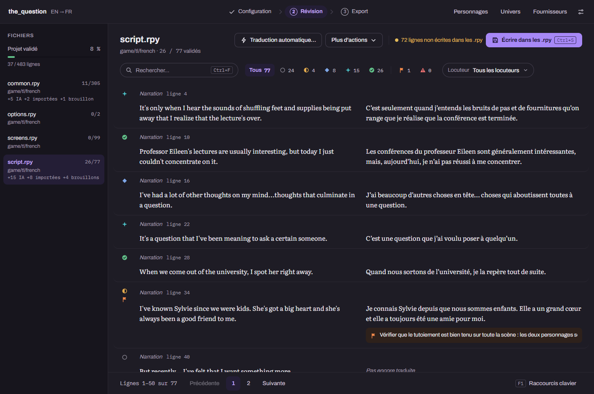
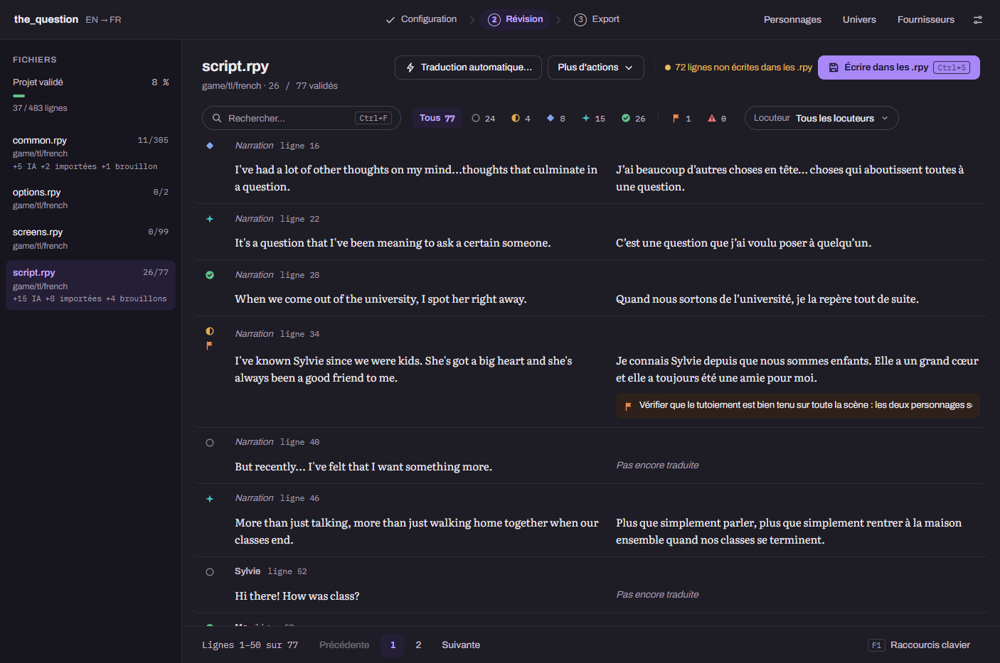
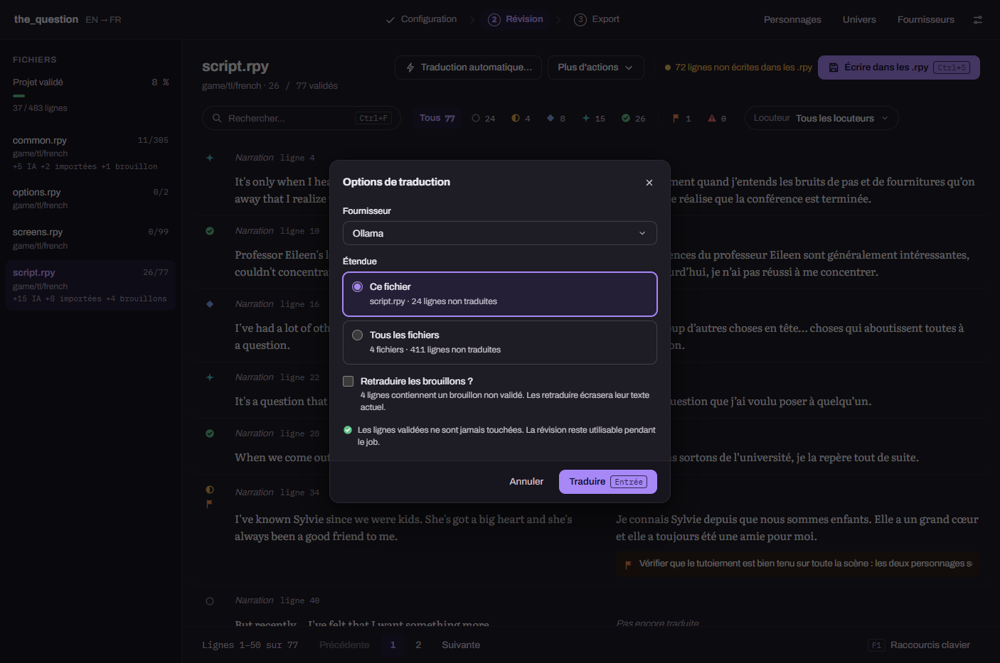

[← Documentation](README.md)

# Écran de révision

*[English version](../en/review-screen.md)*

C'est là que le travail se fait. Tout le reste de l'application s'atteint
depuis cet écran.

## Le panneau des fichiers

À gauche, une entrée par fichier `.rpy` produit par l'extraction, avec la
progression du projet entier au-dessus (*Projet validé*, en pourcentage et
en lignes).

Chaque fichier affiche son nom, son dossier (ou *racine du jeu*) et ses
compteurs : validées sur total, puis combien de lignes sont des suggestions
IA, des importées ou des brouillons (`+4 IA`, `+2 importées`,
`+1 brouillon`). Un fichier à `0/99` n'a pas été commencé ; `26/77` veut
dire vingt-six lignes validées sur soixante-dix-sept. Tant qu'un filtre ou
une recherche est actif, chaque fichier indique aussi combien de ses lignes
correspondent, et ceux qui n'en ont aucune sont atténués.

Un clic droit sur un fichier, ou la touche **Menu** (ou `Maj+F10`) quand il
est sélectionné, propose six actions sur ce seul fichier : *Ouvrir*,
*Copier le chemin*, *Révéler dans l'explorateur*, *Traduire ce fichier…*,
*Importer / exporter…* (le [fichier bilingue](bilingual-files.md)) et
*Effacer les traductions…*.

`common.rpy` est en général le plus gros fichier et le moins intéressant :
il contient les chaînes d'interface de Ren'Py, pas les dialogues du jeu.

## Les filtres

**Statut** est une rangée de boutons qui filtre les lignes du fichier
ouvert : *Tous*, *Non traduits*, *Brouillons*, *Importées*, *Suggestions
IA* et *Validés*, puis deux vues supplémentaires après un séparateur :
*À revoir*, pour les lignes marquées pour un second regard, et *En erreur*,
pour les lignes traduites qu'un contrôle qualité refuse. Hormis *Tous*, les
boutons affichent le glyphe du statut ; survolez-en un pour lire son nom.
Chacun porte le nombre de lignes correspondantes dans le fichier ouvert.

**Locuteur** filtre par personnage. Le menu n'apparaît que si le jeu a des
locuteurs ; il les liste par le nom d'affichage défini dans l'écran
[Personnages](context-for-the-ai.md), ou à défaut par leur nom de variable
dans les scripts du jeu. Pratique pour tenir le registre d'un personnage,
ou traduire toutes ses répliques d'affilée. Les lignes que personne ne dit
sont présentées comme *Narration*.

**Rechercher** (`Ctrl+F`) cherche dans le texte source *et* dans la
traduction : on retrouve donc aussi bien un terme qu'on a employé qu'un
terme qu'on cherche à traduire. `%` et `_` sont cherchés littéralement.

Le compteur sous le nom du fichier — `26 / 77 validés` — décrit toujours le
fichier entier, pas le filtre. Les trois filtres se combinent, et l'écran de
révision les retient (ainsi que le fichier et la page où vous étiez) quand
vous revenez d'un autre écran.

Les lignes s'affichent par pages de cinquante ; `Alt+←` et `Alt+→` tournent
les pages.

## Les lignes

Chaque ligne est un bloc traduisible : son glyphe de statut (avec un glyphe
de drapeau quand elle est signalée et un glyphe d'erreur quand une
validation a été refusée), le locuteur, le numéro de ligne dans le fichier
source, le texte source, et le champ où vous écrivez. Le champ grandit avec
son contenu.

Ce que vous tapez est enregistré dans la base du projet au fil de la frappe ;
la ligne devient un *Brouillon*. Rien n'est perdu si vous changez de fichier
ou quittez l'écran.

Les cinq icônes à droite de la ligne, dans l'ordre (elles apparaissent
quand la ligne est survolée ou a le focus) :

| Icône | Action | Raccourci |
|---|---|---|
| Traduire | Traduire cette seule ligne avec le fournisseur par défaut | |
| Copier | Copier le texte source dans la traduction | `Ctrl+D` |
| Effacer | Vider le champ : la ligne repasse en *Non traduit* | |
| Drapeau | Marquer la ligne pour un second regard | `Ctrl+M` |
| Coche | Valider | `Ctrl+Entrée` |

Valider déplace le curseur sur la ligne suivante, ou sur la première ligne
de la page suivante après la dernière.

Quand d'autres lignes du projet ont exactement le même texte source, un
petit badge `↔ 3` apparaît à côté du numéro de ligne, avec une infobulle qui
les compte dans ce fichier et dans les autres. Après avoir validé une telle
ligne, un message propose *Tout valider* ; cliquer sur le badge fait la même
chose. Valider avec `Ctrl+Maj+Entrée` applique directement la traduction à
ces lignes. Sur un jeu plein de répliques répétées, cela économise beaucoup
de frappe. Seules les lignes qui ne sont pas déjà validées la reçoivent.

Marquer une ligne fait apparaître un champ de **note** dans une bande jaune
sous la traduction. Les notes servent à ce que le texte ne dit pas de
lui-même : un registre à vérifier, un terme à garder cohérent, une ligne
dont le sens dépend d'une branche. Écrire une note marque la ligne. Retirer
le marquage d'une ligne qui porte une note demande confirmation, car la note
disparaît avec lui. Ni le drapeau ni la note ne sont jamais touchés par un
travail de traduction ou un import — seulement par une personne.

À la validation, l'application contrôle la traduction par rapport à la
source :

- Un **refus** (*Validation refusée.*) s'affiche dans une bande rouge et la
  ligne n'est pas validée. Il survient quand une `{balise}` ou une
  `[variable]` de la source manque, quand la traduction ajoute une
  `[variable]` que la source n'a pas, ou quand elle contient une balise
  HTML. Une traduction vide ne peut pas non plus être validée. Les contrôles
  bloquants sont décrits dans le [Dépannage](troubleshooting.md).
- Un **avertissement**, du genre *Traduction 32% plus longue que le texte
  source*, est seulement indicatif : la ligne est validée quand même.

Le filtre *En erreur* liste les lignes traduites qu'un contrôle qualité
refuse.

Quand un assistant connecté par le [serveur MCP](mcp-server.md) écrit dans
le projet pendant que l'écran est ouvert, les lignes affichées sont mises à
jour sur place et marquées *Modifiée par l'assistant* pendant quelques
secondes. La ligne dans laquelle vous tapez n'est jamais touchée, et un
filtre n'est pas ré-appliqué sous vos yeux : une ligne que l'assistant
remplit reste affichée même sous *Non traduits*.

## La barre d'outils

Au-dessus des lignes, la barre d'outils affiche le fichier ouvert et son
compte de lignes validées, puis :

**Traduction automatique…** ouvre les options de traduction : le
fournisseur, l'étendue (*Ce fichier*, *Tous les fichiers*, ou *Lignes
filtrées* quand un filtre est actif) et, s'il existe des brouillons dans
l'étendue, le choix de les retraduire. Elle lance un travail de fond.

Un travail en cours rend compte dans un bandeau et non dans une fenêtre
modale : la révision reste utilisable pendant ce temps ; le bandeau montre la
progression, le nombre d'échecs, un *Journal* et un bouton *Annuler*, puis
*Fermer* une fois le travail terminé. Par défaut, il n'envoie que les lignes
encore *Non traduit*, ce qui rend sûre la correction manuelle d'une mauvaise
suggestion : un travail ultérieur ne l'écrasera pas, et ne la retentera pas
non plus. Les lignes déjà validées ne sont jamais touchées, et celles qui
n'ont rien à traduire (uniquement des symboles ou de la ponctuation) sont
copiées et validées sans être envoyées. Tant qu'un travail tourne, les
autres écrans de l'application sont désactivés.

**Plus d'actions** ouvre un menu de trois entrées :

- *Mémoire* remplit les lignes non traduites de tout le projet depuis la
  [mémoire de traduction](bilingual-files.md#mémoire-de-traduction).
- *Importer / exporter…* fait l'aller-retour en
  [fichier bilingue](bilingual-files.md) pour le fichier ouvert.
- *Effacer…* supprime des traductions en masse. Le dialogue demande où (ce
  fichier ou tous les fichiers) et quelles traductions : tout ce qui n'est
  pas validé par un humain, les suggestions IA uniquement, ou tout, travail
  validé compris. Il indique combien de lignes seront effacées et l'action
  est irréversible. Les drapeaux et les notes sont conservés.

**Écrire dans les .rpy** (`Ctrl+S`) réécrit tout dans `game/tl/<langue>/`.
Le compteur à côté — *72 lignes non écrites dans les .rpy* — indique combien
de modifications ne sont encore que dans la base ; il affiche *Fichiers .rpy
à jour* sinon. Rien n'est perdu si vous partez sans écrire ; les fichiers
sur disque ne sont simplement pas à jour.

Les écrans *Personnages*, *Univers* et *Fournisseurs* (voir
[Contexte pour l'IA](context-for-the-ai.md) et
[Fournisseurs de traduction](translation-providers.md)) s'atteignent par les
boutons en haut de la fenêtre, à côté des étapes.

## Quitter l'écran

Les trois étapes du haut — *Configuration*, *Révision*, *Export* — sont la
sortie dans les deux sens : *Configuration* ramène à la
[configuration du projet](project-setup.md), *Export* mène à l'[export](export.md).

Revenir à la configuration demande confirmation (*Retourner à la
configuration ?*), et les traductions restent enregistrées dans les deux
cas. La navigation hors de l'écran de révision est refusée tant qu'un
travail de traduction tourne : annulez-le ou laissez-le finir.
