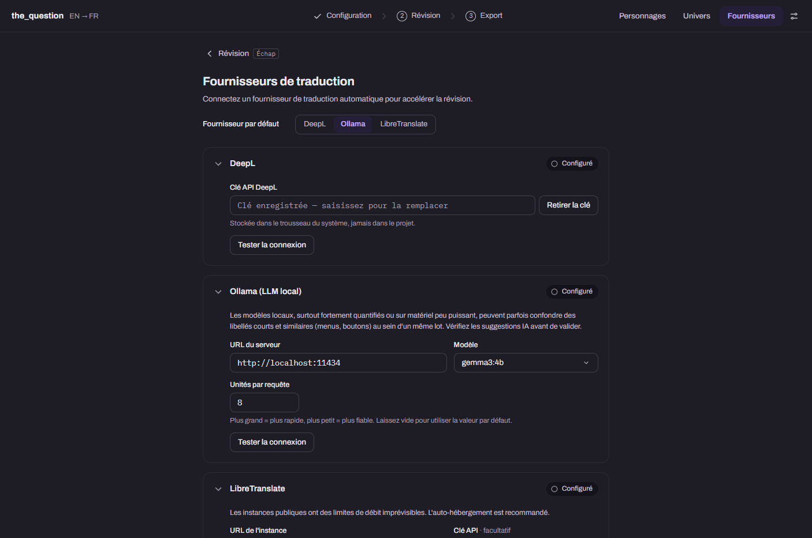
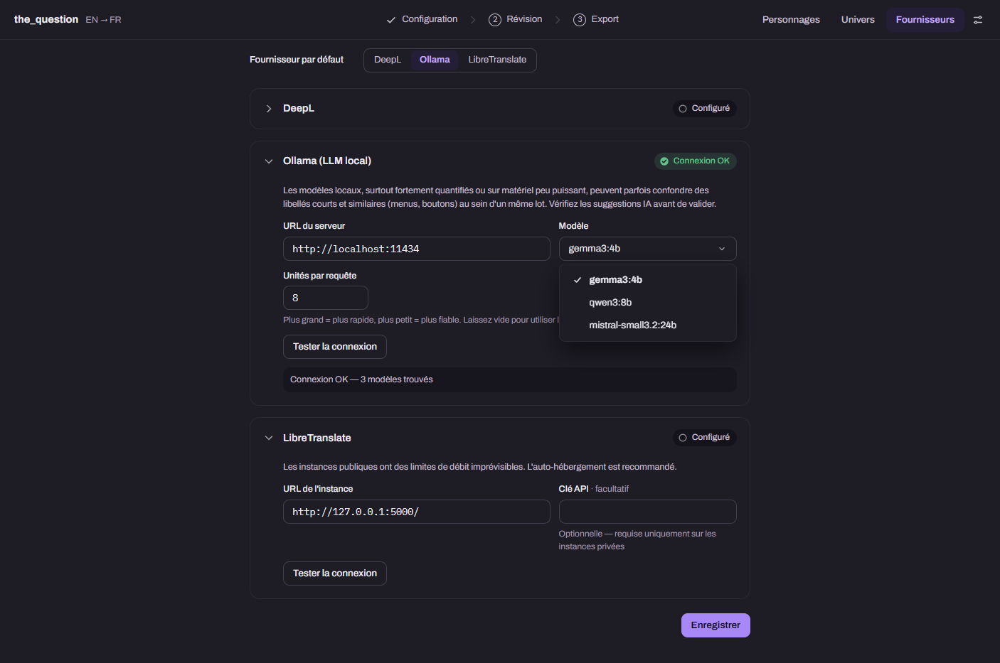

[← Documentation](README.md)

# Fournisseurs de traduction

*[English version](../en/translation-providers.md)*

Trois fournisseurs, accessibles depuis l'entrée **Fournisseurs** de l'en-tête
ou depuis l'engrenage puis **Configurer un fournisseur**. Tout s'enregistre
d'un coup avec le bouton **Enregistrer** en bas de l'écran.

| Fournisseur | Type | Tourne | Demande |
|---|---|---|---|
| [DeepL](https://www.deepl.com) | Traduction automatique | Cloud | Clé API |
| [Ollama](https://ollama.com) | LLM | Local, ou les modèles cloud d'Ollama | Un modèle téléchargé |
| [LibreTranslate](https://libretranslate.com) | Traduction automatique | Cloud ou auto-hébergé | URL, clé si l'instance en demande une |

Chaque fournisseur a sa section, avec un bouton **Tester la connexion** et un
badge : **Configuré** quand une clé, un modèle ou une URL est renseigné,
**Non configuré** sinon, puis **Connexion OK** ou **Erreur** après un test.
Dès que plusieurs fournisseurs sont configurés, un sélecteur **Fournisseur
par défaut** apparaît en haut.

**Aucun fournisseur est une configuration valable.** L'application est
d'abord un outil de révision ; le [serveur MCP](mcp-server.md) est
l'autre façon de faire traduire du texte sans clé API ni GPU.

Si vous vous souvenez de Claude et de Mistral dans des versions antérieures :
ils ont été retirés à la 1.0.0 et ne sont plus disponibles.

## Traduction automatique ou LLM

**DeepL et LibreTranslate** traduisent une chaîne à la fois. Ils sont
rapides, peu chers et prévisibles, et ils ne savent rien de votre jeu :
aucun registre de personnage, aucun terme récurrent, aucune idée de qui
parle.

**Ollama** reçoit le
[résumé d'univers et le glossaire des personnages](context-for-the-ai.md)
à chaque lot : il peut donc tenir un registre et garder un nom propre
cohérent. Il est plus lent, plus cher, et il peut inventer.

DeepL est le seul à gérer un **glossaire côté serveur** : les notes de
personnage écrites `Nom -> Traduction` sont envoyées comme un vrai
glossaire DeepL, synchronisé paresseusement au premier lot.

Seul Ollama peut rédiger le
[résumé d'univers](context-for-the-ai.md) à votre place.

## Ollama

**URL du serveur** — `http://localhost:11434` sauf si vous l'avez déplacé.

**Modèle** — appuyez d'abord sur **Tester la connexion** ; la liste
déroulante affiche ensuite ce que le démon possède réellement. Les modèles
cloud d'Ollama passent par le même point d'accès local, le démon signant
lui-même la requête : ce sont juste d'autres noms dans cette liste, et ils
demandent `ollama signin` plutôt qu'une clé ici.

**Unités par requête** — un nombre entier de 1 à 32 ; plus grand = plus
rapide, plus petit = plus fiable. Laissez vide pour la valeur par défaut (8).

> L'avertissement affiché dans ce panneau n'est pas décoratif. Les modèles
> locaux fortement quantifiés, ou du matériel modeste, confondent
> réellement des libellés courts et similaires — entrées de menu, textes de
> boutons — au sein d'un même lot. Réduisez la taille du lot et relisez les
> suggestions IA avant de valider.

Un modèle local demande un GPU pour être confortable. Sur CPU il marchera,
et il sera lent. Pendant une traduction, l'écran de révision vous signale
quand le modèle est encore en cours de chargement, et quand il tourne en
partie sur le CPU (réduisez alors **Unités par requête** ou choisissez un
modèle plus petit).

Les modèles locaux reçoivent au plus 8192 jetons de contexte, au-delà
desquels la génération s'effondre. Les modèles cloud (dont le nom se termine
par `-cloud`) ne sont pas plafonnés, puisque rien n'est chargé sur votre
machine.

## DeepL

Collez votre **clé API DeepL**. **Tester la connexion** indique combien de
caractères restent ce mois-ci. **Retirer la clé** la supprime du trousseau
après confirmation.

## LibreTranslate

**URL de l'instance** (par exemple `http://localhost:5000`) et **clé API**
facultative, requise uniquement sur les instances privées. Les instances
publiques ont des limites de débit imprévisibles ; l'auto-hébergement est
recommandé. Le service traduisant une chaîne par requête, c'est le plus lent
des trois sur un gros jeu.

Si l'URL utilise `http://` vers un hôte non local alors qu'une clé est
renseignée, un avertissement vous prévient que la clé circulerait en clair.
Utilisez `https://` ou une adresse locale.

## Quand un fournisseur refuse

Une clé rejetée (401, 403), un quota DeepL épuisé (456) ou une limite de
débit (429) arrête la traduction au lieu de la laisser échouer ligne après
ligne. Ce qui était déjà traduit est conservé. Une limite de débit est
d'abord retentée, en patientant quelques secondes entre les essais, avant
que la traduction renonce. Corrigez la clé ou attendez, puis relancez :
seules les lignes pas encore traduites sont envoyées.

## Les clés API

Les clés sont stockées dans le **trousseau du système d'exploitation**, ni
dans le fichier de paramètres ni dans le projet. Elles ne sont jamais
journalisées, même partiellement, ni incluses dans un message d'erreur. Si la
machine n'a pas de trousseau, l'enregistrement d'une clé échoue avec un
message explicite.

## Journalisation détaillée

L'interrupteur **Journalisation détaillée** de la fenêtre des paramètres
(engrenage) écrit plus de détails dans le journal de l'application, que
**Ouvrir le journal** affiche. C'est la première chose à activer quand une
traduction revient fausse ou qu'une connexion échoue.

## Ajouter un fournisseur

Les fournisseurs vivent dans `rust/src-tauri/src/core/translation/providers/`.
En ajouter un demande un module à cet endroit, une entrée dans le registre,
ses clés dans les paramètres, sa section dans l'écran des fournisseurs, ses
chaînes dans les deux locales, et des tests mockés. Voir
[rust/README.md](../../rust/README.md).
