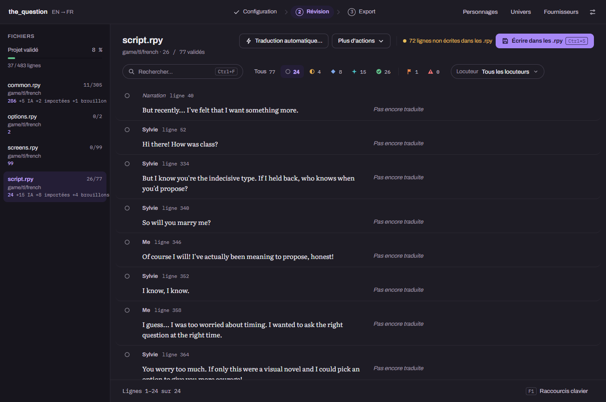
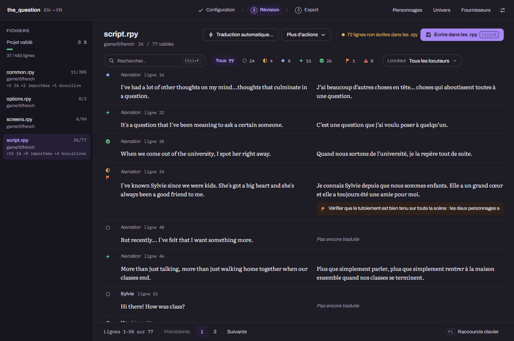

[← Documentation](README.md)

# Statuts de traduction

*[English version](../en/translation-statuses.md)*

Chaque ligne porte exactement un statut parmi cinq, plus un drapeau
indépendant.

## Les cinq statuts

| Statut | Sens | Posé par |
|---|---|---|
| **Non traduit** | Pas encore de traduction | L'extraction |
| **Brouillon** | Édité à la main, non validé | Vous, en tapant |
| **Importé** | Vient d'ailleurs, non relu ici | Traductions déjà présentes dans `tl/` à l'extraction, import de fichier bilingue, mémoire de traduction |
| **Suggestion IA** | Un fournisseur ou un assistant l'a proposée | Un travail de traduction, le serveur MCP |
| **Validé** | Un humain l'a lue et a dit oui | Vous, `Ctrl+Entrée` |

C'est une chaîne, grosso modo `non traduit → suggestion IA → validé`, avec
`brouillon` et `importé` comme deux entrées latérales.

Une ligne dont la source n'a rien à traduire (uniquement des symboles ou de
la ponctuation) fait exception : elle est copiée telle quelle et validée
automatiquement, puisqu'il n'y a rien à relire.

## Les règles qui comptent

**Une ligne validée est protégée.** Un travail de traduction, la mémoire de
traduction, la propagation aux lignes identiques, l'import d'un fichier
bilingue et une soumission du serveur MCP la laissent intacte. Un serveur
lancé avec
`--allow-overwrite-validated` peut la remplacer, et la ligne devient alors
un brouillon. Pour le reste, ce qui dévalide une ligne, c'est vous : taper
dans son champ la passe en brouillon, le bouton d'effacement la
réinitialise, et le dialogue *Effacer* peut atteindre les lignes validées
si vous choisissez *Tout, travail validé compris*.

**Les travaux ne touchent que les lignes non traduites.** Un travail de
traduction n'envoie rien d'autre, sauf si vous lui demandez de retraduire
les brouillons ou de travailler sur un filtre (qui épargne quand même les
lignes validées). Une mauvaise suggestion IA reste donc mauvaise tant que
personne ne s'en occupe — relancer le travail ne la retentera pas.
Effacez-la, corrigez-la, ou filtrez sur *Suggestions IA* et passez-les en
revue.

**Vider un champ réinitialise la ligne.** Un brouillon dont vous supprimez
le texte repasse en `non traduit`, ce qui le remet à portée du prochain
travail.

**La validation est un portillon.** Valider une ligne lance les contrôles
qualité, et une traduction qui perd une `{balise}` ou une `[variable]`,
ajoute une `[variable]` absente de la source, ou contient une balise HTML
est refusée (voir [Écran de révision](review-screen.md#les-lignes)). Les
mêmes contrôles s'appliquent à ce que soumet le serveur MCP et à ce qu'un
fichier bilingue rapporte : une ligne que les contrôles refusent entre en
brouillon plutôt qu'en validée.

## Drapeau et note

À côté du statut vivent un **drapeau** — *à revoir* — et une **note**
facultative. Ce ne sont volontairement pas des statuts :

- Ils survivent à tout. Un travail, un import, un effacement en masse, une
  réextraction : aucun n'efface le drapeau ni la note d'une ligne qui est
  toujours dans le jeu.
- Ils sont orthogonaux à l'avancement. Une ligne peut être signalée alors
  qu'elle est non traduite, validée, ou entre les deux.
- Écrire une note lève le drapeau automatiquement. Rien ne liste les notes
  isolément : une note sans drapeau ne serait retrouvable que par qui se
  souviendrait de la ligne qui la porte.

Filtrez sur *À revoir* pour les traiter.

## Où les statuts apparaissent

- **Dans le panneau des fichiers**, sous forme de compteurs par fichier.
- **Dans la ligne**, sous forme du glyphe de la colonne de gauche. Chacun a
  une forme distincte et un libellé pour lecteur d'écran : l'information ne
  dépend jamais de la seule couleur.
- **Dans l'export**, indirectement : tout ce qui porte du texte est écrit
  dans les fichiers `.rpy`, quel que soit son statut. Les statuts décrivent
  votre confiance, pas ce qui est livré.
